<p align="center">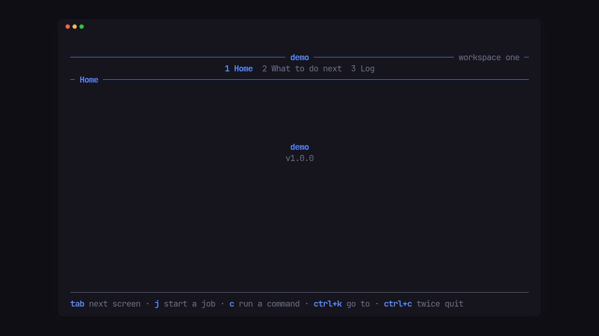</p>

# pito-tui

[](https://github.com/gmrdad82/pito-tui/tags)

The app shell for [PITO MD](https://pitomd.com) terminal apps, as one ratatui 0.30
crate. An app gives it a name, a version and an accent colour, and plugs in its
screens; the shell does everything around them: the terminal, a 120 fps loop,
the keys, the header, the footer, the hourglass while a screen loads, modals,
toasts, a live activity band, a log viewer, and headless dumps for tests and
reviews. Its [header](#the-header), [footer](#the-footer),
[hourglass](#the-hourglass) and [list](#the-list) are part of the crate, and
each also draws on its own, so an app pins one crate. One
[keymap](#keys) declares an app's keys once and gives the footer its hints
and the `?` help sheet its rows.

It has no words of its own: every label, hint and message on screen comes from
the app, in any language.

- **0.07 to 0.31 ms to draw a whole frame**, header, screen and footer, against
  the 8.3 ms a frame gets at 120 fps.
- **Idle, it draws nothing**: the loop sleeps until a key, a worker or a
  deadline wakes it, and redraws only what changed.
- **One line in `Cargo.toml`** brings the shell with its header, footer,
  hourglass and list; 7 direct dependencies, 2 of them only on Unix.
- **A 1.7 MB demo** (stripped release build of 0.4.1).

Works on Linux, Windows and macOS.

Got questions or doubts? Ping me on Discord: https://discord.gg/XsNcn3kYzn

## Install and first use

With Rust installed, the same lines work on Linux, macOS and Windows:

```sh
cargo new hello
cd hello
cargo add pito-tui --git https://github.com/gmrdad82/pito-tui --tag v2.1.0
```

or by hand in `Cargo.toml`:

```toml
pito-tui = { git = "https://github.com/gmrdad82/pito-tui", tag = "v2.1.0" }
```

That one line brings ratatui 0.30 and crossterm 0.29, reachable as
`pito_tui::ratatui` and `pito_tui::crossterm`, and the header, footer,
hourglass and list are part of the crate, as `pito_tui::header`,
`pito_tui::footer`, `pito_tui::hourglass` and `pito_tui::list`, and the
keymap behind the hints and the `?` sheet is `pito_tui::keys`.

Put this in `src/main.rs`, then `cargo run`: a titled screen with a key count,
the hints and version in the footer, and `ctrl+c` twice to quit.

```rust,no_run
use pito_tui::crossterm::event::KeyEvent;
use pito_tui::footer::Hint;
use pito_tui::header::Section;
use pito_tui::ratatui::{Frame, layout::Rect, style::Color, text::Line};
use pito_tui::{Cx, Palette, Screen, Tui, Words, message};

struct Hello {
    presses: usize,
}

impl Screen<()> for Hello {
    fn draw(&mut self, frame: &mut Frame, area: Rect, palette: &Palette) {
        let text = format!("{} keys pressed", self.presses);
        message(frame, area, Line::styled(text, palette.ink));
    }

    fn key(&mut self, _key: KeyEvent, _cx: &mut Cx<'_, ()>) {
        self.presses += 1;
    }

    fn hints(&self) -> Vec<Hint<'_>> {
        vec![Hint::new("any key", "count")]
    }
}

fn main() -> std::io::Result<()> {
    let words = Words::new()
        .help("? help")
        .again("ctrl+c again to quit")
        .yes("Yes")
        .no("No")
        .too_small("Make the window bigger");
    Tui::new("hello", env!("CARGO_PKG_VERSION"), Color::Rgb(0x5b, 0x8c, 0xff))
        .words(words)
        .hints([Hint::new("ctrl+c", "twice quit").pinned()])
        .screen(Section::new("Hello"), Hello { presses: 0 })
        .run()
}
```

To see everything in this README live, run the demo from a checkout
(`ctrl+c` twice quits):

```sh
git clone https://github.com/gmrdad82/pito-tui
cd pito-tui
cargo run --release --example demo
cargo run --release --example demo -- --stack
cargo run --release --example demo -- --dump 100x24 --keys "tab down enter"
```

`ctrl+k` in the demo opens a "Go to" list that reaches every screen and
every layer below; `--stack` shows the header as a row stack with groups,
and `--mono` the monochrome palette.

## Speed

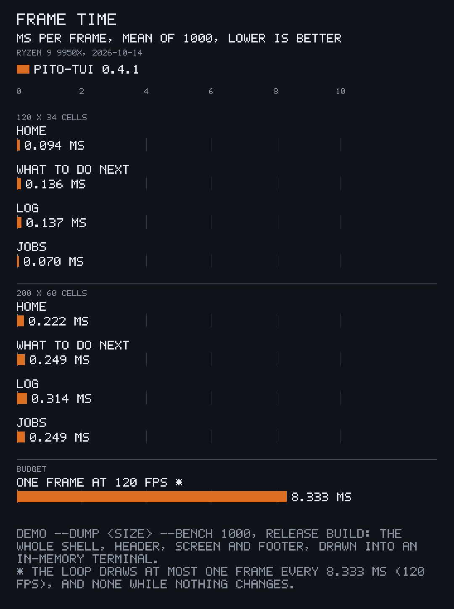

The loop draws at most one frame every 8.333 ms (120 fps), batches every wake
that came in since, and draws nothing while nothing changes. Each frame is a
synchronized update, so the terminal never shows half of one. Drawing reads
the loop's moment, never the clock or the input, so a frame costs only the
drawing:

| Screen | 120x34 average | 120x34 worst | 200x60 average | 200x60 worst |
| --- | --- | --- | --- | --- |
| Home | 0.094 ms | 3.085 ms | 0.222 ms | 1.991 ms |
| What to do next | 0.136 ms | 3.179 ms | 0.249 ms | 1.907 ms |
| Log (20,000 lines) | 0.137 ms | 0.955 ms | 0.314 ms | 6.730 ms |
| Jobs | 0.070 ms | 0.850 ms | 0.249 ms | 2.216 ms |

How it was measured, once, on 2026-10-14: `demo --dump 120x34 --bench 1000`
and `--dump 200x60 --bench 1000` on the release build of pito-tui 0.4.1
(rustc 1.97.1; 1.0.0 draws with the same code), an AMD Ryzen 9 9950X on Linux; `Tui::bench` draws each screen
1,000 times into an in-memory terminal, the whole shell each time, moving the
clock a frame at a time. The machine was busy with other work (load average
about 58 on 32 threads), which shows in the worst frames; every one still
fits the frame budget. Not measured on macOS or Windows.

Size and build of 0.4.1, the same day and machine: the demo's release build
is 2.3 MB, 1.7 MB stripped, and a clean release build of the demo, every
dependency included, takes 39 s. `src/` is 21,486 lines of Rust, tests
included, the header, footer, hourglass and list among them; the crate has 7
direct dependencies, 2 of them only on Unix.

## Features

### A header, a footer and screens

Each screen is a type that implements `Screen`: it draws its area, takes its
keys, and says what it shows in the header and the footer. The shell lays the
screens out as numbered tabs in groups, keeps a breadcrumb when a screen drills
in, and fits the footer's hints to the width. The header can also be a stack of
rows in the app's order: groups with an underlined key, a caption, tabs numbered
within their group, keyboard focus moving through the rows, and a selector after
the tabs.

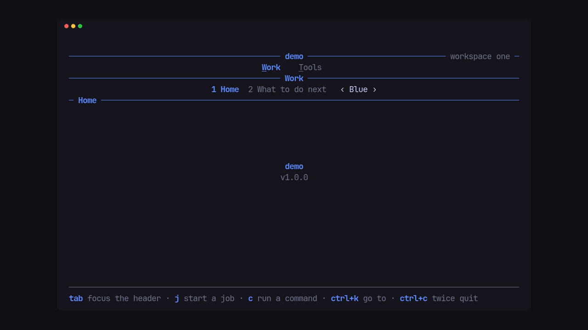

### A quit guard and keys in a fixed order

One `ctrl+c` arms the quit guard until it lapses, a second quits, and while
work runs it asks first, in the app's words. Every key goes through one fixed
order (the guard, a takeover, a modal, a confirm, a pick, the app, the header,
the nav, the screen), so layers never fight over a key.


### One keymap: the hints and the `?` sheet

An app declares its keys once, in groups, with the modes and contexts each
answers in. The footer's hints come from it for wherever the app is, `?`
opens a help sheet of every key (the current mode's first, searchable with
`/`), and a screen asks it what a key does, so the hints, the sheet and the
keys never disagree ([Keys](#keys)).

### Modals

`Cx::open(Modal)` puts a centred, titled container over the live screen, built
from text, lists and fields: filtered pick lists, search boxes, step menus with
a reason field, and forms. A field narrows a list as it is typed, headings are
skipped by the cursor, a risky row needs a second `enter`, and modals stack, so
an alert can sit over a form.


### Bands, takeovers, toasts and gates

A band under the header with a live countdown, a takeover that covers the app
with the hourglass during a switch, toasts that outlive a screen change, and a
gate in front of the app (a lock screen, a sign-in) that takes every key until
the app opens it.


### Activities and real commands

The app hands the shell what it has running, and the shell draws it as a band
on the footer and an activity screen that opens over any screen. `Cx::run`
starts a real child command and follows its `--progress json` lines live; `x`
stops it with a polite signal, then a kill, and no command outlives the app.


### A pick-one prompt

`Cx::pick(Pick::new(title, options))` puts a small list over the screen, and
the answer comes back to the screen that asked. Here it picks the accent, and
the whole palette follows from that one colour.


### A log viewer for 20,000 lines

`Log` holds the lines once, builds only the rows on screen, and scrolls, pages
and jumps to either end; `/` finds every line holding each word, `n` and `N`
step through the hits, and the scrollbar and range count show where you are.
Drawing the Log screen at 200x60 took 0.314 ms on average.


### Sections that fold

`Folds` lays out a column of titled sections the user expands and collapses,
one key for the section under the cursor and one for all of them. A collapsed
section is one row, its title rule ending in a summary the app gives; the body
slides open or shut like a curtain, eased, or at once under reduced motion.
The state is plain data the app saves, and a steady column allocates nothing
per frame.

### Headless runs, dumps and frame captures

`Tui::shot` draws the app at any size after a list of keys, `dump::text` and
`dump::ansi` print it, `Tui::bench` times every screen, and `capture::capture`
and `capture::compare` record every cell of every screen before a big change
and report each cell that moved after it. Time comes from the run, never the
wall clock, so the same app gives the same frames.

```text
$ cargo run --release --example demo -- --dump 72x14 --keys "tab"
 ──────────────────────────────── demo ──────────────── workspace one ─
                    1 Home  2 What to do next  3 Log
                                5 steps
 ─ What to do next ────────────────────────────────────────────────────
    Step                        How
  ▌ Replace this screen         Home and Next are two Screen types; s…
    Set your accent             Tui::new takes one colour, or Palette…
    Add your first command      a key in Screen::key, its work in Cx:…
    Load real data              Screen::load returns the read; Screen…
    Wire the headless flags     --dump, --keys, --at, --bench, --capt…

 ──────────────────────────────────────────────────────────────────────
 ↑↓ move · enter open · / filter · ctrl+k go to · ctrl+c twice quit
```

### A terminal that is always given back

`Term` turns on raw mode, the alternate screen and bracketed paste, remembers
each one, and turns exactly those off again on quit, on an error, on a hangup
or termination signal, and on a panic, before the panic message prints.
On the alternate screen (not on Windows) it also asks the terminal for key
event types and turns off its alternate scroll, so the wheel sends no arrows
where the terminal honours that, and in kitty the wheel's arrow
press-and-release pairs are dropped; either way the wheel doesn't move a list
like arrow keys, and real arrows and held keys work as before.

### A header, a footer, an hourglass and a list of its own

The shell draws with four widgets that are part of the crate, and an app
uses each on its own inside a screen or in a loop of its own:
[the header](#the-header), [the footer](#the-footer),
[the hourglass](#the-hourglass) and [the list](#the-list), each with its own
part below.

## Part of PITO MD

pito-tui is the shell of the [PITO MD](https://pitomd.com) terminal apps, and
it carries their terminal widgets:

- [The header](#the-header): the groups, tabs, breadcrumb and facts rule at
  the top.
- [The footer](#the-footer): the key hints, notice line, confirm, input and
  quit guard at the bottom.
- [The hourglass](#the-hourglass): the Braille hourglass shown while a screen
  loads.
- [The list](#the-list): the selectable rows, scrollbar and range count of
  every list.
- [Keys](#keys): the one keymap behind an app's actions, its footer hints
  and its `?` help sheet.

Its README visuals come from the PITO MD tools too:
[prec](https://github.com/gmrdad82/prec) records the demo and the widgets'
examples frame by frame and takes their stills,
[pcod](https://github.com/gmrdad82/pito-codecs) (pito-codecs) turns the recordings into GIFs, and
[pito-compare](https://github.com/gmrdad82/pito-compare) draws the frame-time
and draw-time charts.

## Everything it does

- **Screens, plugged in.** Each screen is a type that implements `Screen`:
  it draws its area, takes its keys, and says what it shows in the header
  (facts, a status, a breadcrumb) and the footer (hints, an input bar). The
  shell lays them out as numbered tabs in groups ([the header](#the-header)), switches
  between them with the app's nav keys, and starts a screen the first time
  it is shown. A screen hears each time the nav brings it up (`entered`):
  a tab, group or digit key, the digit of the screen already shown too, a
  click on its tab, or `go`; not the first screen at start. Tabs are
  numbered from 1, the tenth on `0`; `NavKeys::HEY.zero_first(true)` numbers
  them from `0`, and tabs past the tenth then show no digit and are reached
  with `]`, `[` and the group keys.
- **Loads that can't land late.** A screen hands the shell its read
  (`load`), the shell runs it on a worker and delivers the answer
  (`loaded`) only if it is still the newest one: each read carries a
  generation, so an answer that comes back after the user stopped waiting,
  or after a newer read, is dropped. While a screen loads, the shell shows
  the hourglass ([the hourglass](#the-hourglass)) with the screen's own words; a stop key
  (`esc` unless the app picks others) stops waiting. `Cx::changed(source)`
  marks every screen that reads that source stale, and they read again.
- **Timed work without a key.** A screen's `deadline` wakes the loop, and
  when the loop's moment reaches it the shell calls the screen's `tick`,
  once for each deadline the screen gives, whichever screen is showing: a
  poll every few seconds, a read that timed out. The same happens in
  `settle` and when `Tui::advance` moves the clock of a headless run.
- **A 120 fps paced loop that never blocks the UI thread.** An input thread
  and the app's workers wake one channel; the loop drains every wake in a
  batch, redraws only when something changed, no more often than every
  8.3 ms, and otherwise sleeps until the next wake or deadline (the quit
  notice running out, a screen's own deadline, the next frame of an
  activity's spinner). Every frame is a
  synchronized update, so the terminal never shows half of one. Idle, it
  draws nothing.
- **Keys in a fixed order:** a key release is ignored; then the quit guard
  (a double `ctrl+c`, asking first while work runs, with the app's words);
  then a takeover, which hears only its cancel keys; then the open `?`
  sheet, which takes its own keys and passes on the rest, and closes when a
  key it passed on leaves a layer or a typing input up; then the modal on top;
  then an open confirm, unless the key is one the app lets through
  (`through_keys`, such as `ctrl+r` for a refresh), which goes to `on_key`
  and the screen with the confirm left open; then an open pick; then the
  app slot's `claim`; then a gate, which takes every other key; then a
  screen that is typing into an input; then the help toggle (`?`, which
  opens the sheet when the app gave the shell a keymap); then the
  header's focus keys and, while a header row has focus, its arrows; then
  the keys that open an overlay (the activity screen or the app's own);
  then the nav keys (only the back keys while an overlay is open), the
  group keys and the number keys; then the stop key while a screen loads;
  then the app's own keys (`on_key`); then the screen. `Cx::key` tells a
  callback which key led to it, so `back` knows `esc` from `q`.
- **A terminal that is always given back.** `Term` turns on raw mode, the
  alternate screen and bracketed paste (mouse capture and focus events only
  when the app asks), remembers each one it turned on, and turns exactly
  those off again on quit, on an error, on a hangup or a termination
  signal while the loop runs, and on a panic on the UI thread, before the
  panic message prints. On the alternate screen (not on Windows) it pushes
  the keyboard event-type flags and turns off alternate scroll, so the wheel
  sends no arrows where the terminal honours that, in kitty the wheel's arrow
  pairs are dropped, and the wheel doesn't move a list like arrow keys; real
  arrows and held keys are unchanged. A panic on a worker thread leaves the
  running app alone. The app's own panic hook still runs after it, and a
  hook that ends the process calls `pito_tui::restore()` first: any thread
  may call it, the first call gives the terminal back and waits for a frame
  being drawn to finish, later calls do nothing, and the shell draws nothing
  after it.
- **A palette from one colour, or a whole one.** `Palette::new(accent)`
  derives every style the header, footer, list and hourglass draw with;
  `Palette` also takes each token by hand (base, ink, strong, muted,
  accent, selected, good, warn, bad, rule, line, glass, shimmer, title,
  inactive, focus, small). `Cx::palette` swaps it while the app runs, and
  the hourglass follows. `Palette::tone(Tone)` turns the shell's `Tone`
  (`Ink`, `Strong`, `Muted`, `Accent`, `Good`, `Warn`, `Bad`) into a style
  for toasts and modal status lines. Named colour roles, one per app mode,
  come from `Tui::role(name, style)`, and `Cx::role(Some(name))` makes one
  active: the title and the hourglass take it. `Palette::mono()` lets
  reverse, bold and dim stand in for colour; `Tui::run` uses it when
  `NO_COLOR` is set, and `Tui::monochrome(true)` forces it (headless runs
  stay as built, so a capture doesn't depend on the environment).
- **The footer, assembled:** the screen's hints and the app's, the notice
  line, the confirm bar, the input bar, and the app's name and version at
  the right end of the row of keys (the footer's version slot). The notice
  line is the first that speaks of: the quit guard, what a screen said with
  `Cx::say` (gone at the next key), the screen's own `notice` (in any tone,
  for as long as the screen keeps it, such as an error until the next
  action), and the screen's `legend` while the hints show. While an input
  bar or a confirm is open, the quit guard's word takes the bar's hint row,
  in the accent, and the bar's own hint comes back when the guard lapses;
  with `lit_again(false)` it takes an input bar's hint row in the bar's own
  hint style, and a confirm keeps its own hint.
  The quit question has its own hint (`Words::leave`), falling back to the
  confirm's (`Words::choose`). `?` hides the hints; the header then shows
  the app's help word. `quit_sticky(true)` keeps the armed guard through
  other keys, from any layer, until it lapses or quits; `quit_tone` gives
  its word a tone (`footer::Tone::Alert`, say) and `quit_hints(false)` hides
  the hints while it is armed. `version_fit(true)` shows the name and
  version only when they cost the footer no extra row and the quit guard
  is quiet. While a modal or pick owns the keys, only the app's pinned
  hints stay beside its own.
- **Hints and a help sheet from one keymap:** `Tui::keymap(&KEYS)` hands the
  shell the app's `keys::Keymap`, and `Tui::keys_now(now)` or
  `cx.keys_now(now)` tells it where the app is (the mode and the contexts
  that hold). The footer shows the keymap's live hints for that place, in
  its order, ranks and words, before the app's `Tui::hints`; `?` opens the
  sheet instead of hiding the hints, a centred overlay over the screen with
  the current mode's keys first, every key's words and notes, the search
  while typing, and a page at a time with pgdn and pgup when it outgrows
  the area. It eases open and closed over 180 ms (`still(true)` shows it at
  once), and a steady frame with it open allocates nothing. Without a
  keymap, `?` shows and hides the hints as before.
- **The header, assembled:** the app's name on the title rule, with the help
  word and the screen's `lead` on its left and the screen's status on its
  right, each in styled parts and each told the room it has, so a screen
  can drop a part that won't fit rather than see it cut; the groups and
  screens as tabs; the screen's facts; and its breadcrumb kept in step:
  when a screen opens something (`crumb`), the sections row becomes the
  breadcrumb, and the nav's back key (`esc`, `q`) calls the screen's
  `back`. The facts row goes while a screen is drilled in, unless the app
  keeps it (`keep_facts`), on the same row. A screen that wants the whole
  left side, the help word joined to its lead in its own style, gives it
  in `left(room, help)`: `help` is the help word when the shell would show
  it (the hints hidden), and `None` keeps the shell's join. The title is the
  app's name until `Tui::title`, `Cx::title` or `Cx::title_spans` changes
  it, while the app runs too ("demo · locked").
- **The header as a stack of rows.** `Tui::head(Head::new([..]))` draws the
  header from rows in the app's order, each optional: `Row::Title` (the
  title rule), `Groups`, `Caption` (a ruled label between two rows: the
  current group's name, or the screen's `caption()`), `Sections`, `Facts`,
  `Crumbs` (the breadcrumb rule) and `Blank`. Groups and tabs take a
  `Label`: styled spans, an underlined accelerator letter, say, with a
  short form for narrow widths; the current one is drawn lit, the others in
  `Palette::inactive`. `Head::numbers` numbers the tabs across the app
  (`Across`), within their group (`InGroup`, starting at 1 in each) or not
  at all (`Off`), `Head::lone(true)` leaves a group of one tab unnumbered,
  and the number keys follow what is drawn. A screen's `after_tabs()` spans
  sit after the tabs on the sections row, a "‹ value ›" selector in place
  of a facts row. `Tui::focus_keys(next, previous)` moves keyboard focus
  through the groups row, the sections row, that slot and the content: the
  focused row's current item takes `Palette::focus`, left and right move
  along it, up and down move between rows, and `esc` or `enter` gives
  focus back; in the slot, keys reach the screen and `Cx::focus()` says
  `Focus::Slot`. `Tui::group_keys(keys)` gives the group added last its
  keys, and they (or `Cx::go_group(n)`) return to that group's last-used
  tab. `Tui::show` and `Cx::show(|item| ..)` show or hide groups and tabs
  by the app's predicate (`Item::Group(n)`, `Item::Tab(screen)`) whenever
  the app says, keeping each group's last tab and the current tab while it
  is shown. Without `head`, the header is the header module's own layout,
  and `header_look` applies to it.
- **The app slot.** `Tui::app(screen)` adds one app-level screen that is
  never drawn as content. Its `lead`, `left`, `status_parts` and `badge`
  feed the title rule on every screen (a screen's own show only when it gives
  none), so app-wide indicators come from one place. It hears app-wide
  keys first in `Screen::claim(key, cx) -> bool`, over a gate, a typing
  screen or any screen (`Cx::typing()` says when the screen in front takes
  text), and everything it opens (a modal, a pick, a confirm, a takeover,
  a detach or a command) answers to it rather than to a screen.
- **Layers.** `Tui::gate(screen, shut)` puts a gate before the app: the
  title rule over the gate's own box, no tabs, no help and only the gate's
  own hints, every key the gate's after the quit guard, open prompts and
  the app's claim; `Cx::gate(false)` reveals the app (entering its current
  screen) and `Cx::gate(true)` shuts it again. `Cx::takeover(Takeover)`
  covers the app for an app-wide transition: its text on the title rule,
  the hourglass under it, tabs and footer hidden, every key ignored but its
  cancel keys (the app hears `layer::Event::Closed`) and the quit guard,
  until `Cx::end_takeover()`. `Cx::open(Modal)` puts a container over the
  live screen, which keeps drawing: centred, bordered and titled, owning
  the keys until it closes, its body built from parts in order (`text`, a
  `list` of `Choice`s and `Field`s, tab and shift+tab moving focus between
  them), one primitive for filtered pick lists, search boxes, step menus
  with a reason field, and forms. `Modal::filter(field, list)` narrows a
  list as the field is typed, `Choice::skip()` is a heading the cursor
  passes over, `Choice::confirm(warning)` needs a second enter and shows
  its warning on the status line (`Modal::status(text, tone)`), and
  `Cx::modal(id)` changes rows and status while it is open. The screen that
  opened it hears `Screen::layer(id, Event)`: `Chosen`, `Moved`, `Edited`, `Submitted` and
  `Closed`; `Cx::close(id)` closes it. Modals stack, so an alert can sit
  over a form. `Cx::alert(id, title, lines)` is a dismiss-only one: `esc`,
  `enter` or `q` closes it.
- **Toasts and a band under the header.** `Cx::toast(Toast::new(text))`
  shows an app-wide notice over the content, `.at(Spot::TOP_RIGHT)` unless
  placed elsewhere, `.tone(Tone::Good)`, stacked with the others at its
  spot, surviving screen changes and leaving on its own after `.lasting(..)`
  (3 s unless set), with one redraw. `Tui::top_band(impl Band)` draws a
  band under the header with the same `Band` trait as the footer's, a
  one-row banner with a live countdown, say, waking for its `deadline`.
- **Layout.** `Tui::layout(Layout::new()...)` (or `Cx::layout`) sets the
  top and bottom margins, the side margin of the header and footer, the
  content's padding, the gap under the header and the gap above the
  footer, and the `Spot` where the too-small words sit (in
  `Palette::small`). A `Spot` places a box by an `Edge` on each axis
  (`Start`, `Third`, `Middle`, `End`); `message_at` places text by one.
- **Activities.** The app hands the shell what it has running (`Cx::activity`,
  `Cx::activities`, `Cx::forget`): each with a label, a state (running,
  waiting, done, failed, stopped), a progress fraction or none (a spinner then), when
  it started and ended, a short status line and the detail lines it opens
  into (a log, its steps). The shell draws them as a band flush on the
  footer, the newest first, taking up to half the room, with a finished one
  fading for 3 s before it goes; the app turns the band on and off
  (`Cx::band`). A key the app picks opens the activity screen over any
  screen, outside the tabs: the tabs unlit, only the back keys, its own
  breadcrumb row ("Operations / update pfx"), every activity listed, and
  `enter` opening one into its detail lines. Every word on them is the
  app's (`Activities`), and the data stays the app's: the shell only draws,
  pages and takes the keys, and its time is the loop's moment.
  `Cx::activities` replaces the app's own list and leaves the commands'
  activities (below) where they are.
- **The app's own band and overlays.** `Tui::band(impl Band)` draws the
  band from the app's own data in place of the activity band: the shell
  asks its `height` for the room between the header and the footer (and
  never gives it the content's blank row), places it flush on the footer
  with that blank row above, draws it on every screen and under every
  overlay, picker and confirm, and wakes for its `deadline`.
  `Tui::overlay(section, keys, screen)` opens an app's own screen the way
  the activity screen opens: by its keys over any screen, the tabs unlit,
  only the back keys, its own breadcrumb row (the section's name, then the
  screen's crumb: "Operations / update pfx"), and its confirms and picks
  answered to it. Overlays come after every tab and keep their builder
  order with the gate and the app; one added after `Tui::activities` comes before the activity screen, and so before a gate or app added after it. A screen that wants a digit to switch
  tabs from it calls `Cx::go`.
- **Commands on the band.** `Cx::run(id, label, Command)` runs a child
  command and follows the `--progress json` lines the PITO MD command-line
  tools print (version 1: one object a line with `state` start, progress,
  done, fail or end, and `stage`, `fraction`, `msg` and, on the end line,
  `ok`; unknown fields are ignored), so an app that drives its own CLI shows
  that command's progress live with no glue. The lines come from stdout;
  `Cx::run_from(id, label, Command, command::Stream::Stderr)` follows them
  on stderr instead, and `Stream::Both` on both. Every line on either stream
  goes into the activity's detail (a progress line as a short note); the
  activity ends on the `end` line, or with the command's exit status.
  `Cx::stop(id)` ends a running command: a polite signal (`SIGTERM` to the
  process group the command runs in on Unix, so whatever it started ends
  too), then a kill after `command::GRACE` (2 s) if it is still running. The
  activity shows as stopped at once and keeps its status and detail; lines
  printed after that no longer change it. `command::read` parses one line.
  While a command runs it counts as busy for the quit guard. When
  `Tui::run` or `run_in` returns, for a quit or anything else, every
  command still running gets the same polite signal; `run_in` waits up to
  `command::GRACE` for them to end, kills the ones still running, and only
  then returns, so no command outlives the loop that started it, and a
  command queued but not yet started never starts. The terminal going away
  or the app being told to end does the same: while the loop runs, on Unix,
  `SIGHUP`, `SIGTERM` and `SIGINT` end it as a quit does, without asking,
  every command it started is stopped that way, forgotten ones too, the
  terminal is given back, and then the process ends by that same signal,
  as it would have without the shell (`Wake::Signal` is the wake that ends
  the loop). Before the loop and after it, those signals keep their
  default action. Headless runs never spawn a command, and a stop there
  marks a queued one stopped.
- **The app hears its commands.** The screen that ran a command hears it in
  `Screen::heard(id, command::Heard, cx)`: every line in the order it came,
  as `Heard::Line { stream, text, progress }` (the raw text, the stream it
  came on, and the parsed progress when it came on the stream the app
  follows, so the app reads its own fields from `text`), then once
  `Heard::Exit` with a `command::Exit`: `Code(n)`, `Signal(n)`, `Stopped`,
  or `Error(text)` when it never started or couldn't be waited on.
  `Exit::state` maps it to done, failed or stopped. Lines arrive in batches,
  at most every 100 ms. The band follows the progress lines until the app
  posts its own activity for that id (`Cx::activity`): from then on the band
  shows the app's label, status, progress, state and start, the command's
  lines only fill its detail, and the shell still holds the process, the
  stop and the busy count. If the app hasn't ended it by the time the
  command exits or is stopped, the shell ends it by `Exit::state` and keeps
  the app's status. `Cx::run_from` keeps the start of an unfinished activity
  already on the board under that id (one shown waiting first), and
  `Cx::forget` takes a command's activity off the board for good: the shell
  stops keeping that command's lines, and the screen still hears every one
  in `heard`.
- **A pick-one prompt.** `Cx::pick(Pick::new(title, options))` puts a small
  list over the screen: arrows (or `j`, `k`, `g`, `G`) move, `enter`
  chooses, `esc` or `q` cancels, every key goes to it while it is open, its
  hints replace the screen's, and the answer comes back to the screen that
  asked, in `picked`. `Pick::full(true)` fills the screen's area instead of
  a box: the title as a heading, a blank row, then the list;
  `Pick::columns` lays the rows out in the app's own columns.
- **A log viewer.** `Log` is a pane a screen embeds for a 20,000-line log or
  a 10,000-event trace: it holds the lines once (`Arc`), builds only the
  rows on screen, clips rather than wraps, and scrolls, pages and jumps to
  either end (`g`, `G`); `/` finds every line holding each word of the
  query, `n` and `N` step through them, and `y` copies the page and `Y`
  every line. At the bottom it follows new lines, unless `follow(false)`
  keeps its place. A list that big wants the list's `Shared`, which builds
  only the rows on screen from the app's own items. The activity screen's
  detail is a `Log`.
- **A scrollbar and a range count.** `Palette::bar(Some(list::Bar::LINE))`
  and `Palette::count(Some(list::Count::new("–", " of ").group(",")))` hold
  the app's choice once; `Palette::view(&mut list, &columns)` gives any
  list a screen draws the app's styles, bar and count (shown only when the
  list overflows, every word the app's). The pick, the
  activity screen, `Filter::view` and the modal lists use it, and `Log`
  draws the same bar beside its lines and the count on its bottom line.
- **Time, bars and spinners.** `clock::span` ("1m 2s", "2d 1h") and
  `clock::span_hours` ("49h 3m", never days, for a "took") and
  `clock::age` ("3m") in the app's own unit words (`clock::Units`, with
  optional words for under a second, "under 1s", for an age under a minute,
  "just now", and a year unit for ages of 365 days and more), and
  `clock::next_span` and `next_age`, the moment the text may next change, for a
  screen's `deadline`; `progress::bar` (a Braille bar, `⣿⣿⣿⣀⣀`),
  `progress::share` ("41%", or "≈57%" for an estimate) and
  `progress::spinner`. The activity band draws an estimate's bar faint
  (`Activity::estimate`).
- **A filter over a list.** `Filter` holds a `list::List`, a `footer::Input`
  and the rows that match; `/` starts typing, `enter` keeps the
  filter, `esc` clears it, and the keys are the app's to change.
- **Loads that never flash.** `Tui::hourglass_timing(delay, least)`: a load
  shorter than `delay` shows nothing, and an hourglass once shown stays at
  least `least`, so quick reads stay quiet and slow ones never blink.
- **An epoch.** `Cx::epoch()` marks the app changing mode (another account,
  another workspace): detach jobs and reads started before it, and waker
  events sent before it, are dropped, and every started screen reads
  again. A waker made earlier still delivers what it sends after, so a
  long-lived watcher keeps working.
- **The rest of the glue:** a too-small guard with the app's message, OSC 52
  copy (`Cx::copy`, up to 48 KiB), a y/n confirm whose answer comes back to
  the screen that asked, an optional callback after every draw with the time
  it took, and width-aware text helpers (`text::cut` and `clip` after a whole
  word, a `/`, `-` or `_` with "…", never after a bare number, dropping whole
  " · " parts; `fit`, `wrap` at spaces, `hard_wrap` at the width). The status
  line, tab tail, fold titles and toasts cut the same way.
- **Headless.** `Tui::shot` draws the app at any size after a list of keys,
  `Tui::advance` moves the run's clock (the hourglass as if it had run that
  long, deadlines ticking), `dump::text` and `dump::ansi` print the result,
  `dump::keys` reads a `--keys` string and `Tui::bench` times every screen,
  moving the clock a frame at a time. Time never comes from the wall clock
  there: drawing reads the loop's moment, which a screen sees in `moment`
  before each frame. The app wires them to its own flags.
- **Frames before and after.** `capture::capture` walks every screen on its
  own, and the app's key scripts for deeper states (a drill-in, a confirm, a
  search, the quit guard, the hourglass at a given moment), at a list of
  sizes, and saves every cell (its symbol, colours and modifiers) to a
  directory; `capture::compare` walks the same again and reports each cell
  that differs, by screen, size and position, before and after. Time comes
  from the run and data from the app's own fixtures, so the same app gives
  the same frames. It is a safety net for a big change: capture, change,
  compare, and delete the captures. It is not a test to keep, and it pins
  no wording. An app still on its own loop records the same frames from its
  own headless buffers with `capture::Recorder`, so `compare` proves its
  move onto the shell; an app that keeps its own loop compares its states
  against a capture with `Recorder::against`, and any two captures compare
  with `capture::compare_dirs`.

## The demo

`examples/demo.rs` is the fuller starting point: two screens, a read with
the hourglass, a filtered list, a drill-in with a breadcrumb and copy, fake
jobs with progress on the activity band and screen (`j` starts one, `o`
lists them), a real command on the band (`c` runs the demo itself as a
child printing progress lines, `x` stops it), a pick-one prompt (`p` picks
the accent), a 20,000-line log with find and copy (the Log tab), a time
label kept fresh by a deadline, an app-wide key that swaps the palette, an
app slot whose `ctrl+k` opens a "Go to" modal reaching a lock gate, a
workspace switch under a takeover (ending in an epoch, a role and a toast),
a paused band under the header and an alert, the header as a row stack
(`--stack`), the monochrome palette (`--mono`), and the headless flags,
`--capture DIR` and `--compare DIR` among them.

## The API

```text
Tui::new(name, version, accent: Color) -> Tui<E>          // E: the app's worker answers
  .palette(Palette) .words(Words) .hints([Hint<'static>]) .min_size(w, h)
  .group(impl Into<Label>) .group_keys(&[footer::Key]) .screen(impl Into<Label>, impl Screen<E>)
  .show(Fn(Item) -> bool) .head(Head) .focus_keys(next, previous) .title(text) .title_spans([(text, Style)])
  .layout(Layout) .role(name, Style) .monochrome(bool) .hourglass_timing(delay, least) .version_fit(bool)
  .nav_keys(NavKeys) .help(Option<Help>) .quit(Mode) .quit_window(Duration)
  .quit_keys(&[footer::Key]) .quit_sticky(bool) .quit_tone(footer::Tone) .quit_hints(bool)
  .stop_keys(&[footer::Key]) .eager(bool) .keep_facts(bool)
  .modes(Modes) .activities(Activities) .overlay(header::Section, &[footer::Key], impl Screen<E>)
  .app(impl Screen<E>) .gate(impl Screen<E>, shut: bool)
  .band(impl Band) .top_band(impl Band) .lit_again(bool) .through_keys(&[footer::Key])
  .header_look(fn(Header) -> Header) .footer_look(fn(Footer, width: u16) -> Footer)
  .on_key(FnMut(KeyEvent, &mut Cx<E>) -> bool) .after_draw(FnMut(Duration))
  .keymap(&'static keys::Keymap<A>) .keys_now(keys::Now) .still(bool)  // the hints and the ? sheet
  run() -> io::Result<()>, run_in(&mut Term)
  key(KeyEvent) -> Flow, paste(&str) -> Flow, mouse(MouseEvent) -> Flow, event(screen, E) -> Flow, handle(Wake<E>) -> Flow
  loaded(screen, generation, E) -> bool, landed(screen, generation, E) -> Option<Flow>  // None: a late or unknown load
  changed(source), go(screen) -> bool, start() -> Flow  // a quit from go comes back from start, settle or the next wake
  pump(), settle() -> Flow, advance(Duration) -> Flow, draw(&mut Frame), busy(), current(), names()
  find::<T>(), find_mut::<T>(), sender(), waker(screen), set_palette(..), set_words(..), set_layout(..)
  set_keys_now(keys::Now), sheet() -> &keys::Sheet
  frame(w, h) -> Buffer, shot(w, h, &[KeyEvent], settle) -> Buffer, bench(w, h, frames) -> Vec<Bench>
pub enum Flow { Stay, Quit }

pub trait Screen<E>: Any {                                 // every method but draw has a default
  fn draw(&mut self, &mut Frame, Rect, &Palette);
  fn moment(&mut self, now: Instant);                      // the loop's moment, before each draw
  fn phase(&self) -> Phase;                                // Ready | Loading(label) | Trouble(lines)
  fn load(&mut self) -> Option<Job<E>>;  fn loaded(&mut self, E, &mut Cx<E>);
  fn sources(&self) -> &[&str];  fn cancel(&mut self);  fn start(&mut self, &mut Cx<E>);
  fn entered(&mut self, &mut Cx<E>);                       // each time the nav brings it up
  fn key(&mut self, KeyEvent, &mut Cx<E>);  fn paste(&mut self, &str, &mut Cx<E>);
  fn mouse(&mut self, MouseEvent, Rect, &mut Cx<E>);  fn event(&mut self, E, &mut Cx<E>);
  fn answer(&mut self, yes: bool, &mut Cx<E>);  fn picked(&mut self, Option<usize>, &mut Cx<E>);
  fn heard(&mut self, id: u64, command::Heard, &mut Cx<E>);  // a command it ran: each line, then the exit
  fn layer(&mut self, id: u64, layer::Event, &mut Cx<E>);  // a modal or takeover it opened
  fn claim(&mut self, KeyEvent, &mut Cx<E>) -> bool;       // the app slot's app-wide keys, first
  fn back(&mut self, &mut Cx<E>);
  fn after_tabs(&self) -> Vec<(String, Style)>;            // after the tabs, with Tui::head
  fn caption(&self) -> Option<Vec<(String, Style)>>;      // Row::Caption's label
  fn hints(&self) -> Vec<Hint>;  fn facts(&self) -> Vec<(String, Style)>;
  fn hint_list(&self) -> &[Hint<'static>];  fn fact_spans(&self) -> &[Span];  // borrowed; drawn in place of hints, facts when not empty
  fn status(&self) -> Option<(String, Style)>;
  fn status_parts(&self, room: u16) -> Vec<(String, Style)>;  // default: status() as one part
  fn badge(&self) -> &[Span];  // after the status and a space; Span = (Cow<'static, str>, Style)
  fn lead(&self, room: u16) -> Vec<(String, Style)>;      // beside the help word
  fn left(&self, room: u16, help: Option<&str>) -> Option<Vec<(String, Style)>>;  // the whole left side
  fn notice(&self) -> Option<Notice>;  fn legend(&self) -> Option<&str>;
  fn typing(&self) -> bool;
  fn input(&self) -> Option<InputBar>;  fn crumb(&self) -> Option<String>;
  fn selected(&self) -> usize;  fn busy(&self) -> usize;
  fn animating(&self) -> bool;  fn deadline(&self) -> Option<Instant>;
  fn tick(&mut self, &mut Cx<E>);                          // once when the moment reaches a deadline
}
pub type Job<E> = Box<dyn FnOnce() -> E + Send>;
pub trait Band {                                           // the app's own band, Tui::band
  fn height(&self, room: u16, now: Instant) -> u16;
  fn draw(&mut self, &mut Frame, Rect, &Palette, now: Instant);
  fn deadline(&self, now: Instant) -> Option<Instant>;     // default None
}

Cx<'_, E>: screen(), now(), key() -> Option<KeyEvent>, detach(FnOnce() -> E), waker() -> Waker<E>,
  say(text, footer::Tone), hush(), confirm(question), confirm_with(question, Confirm),
  copy(text) -> bool, go(screen), quit(), reload(), changed(source),
  palette(Palette), words(Words), hints(Vec<Hint<'static>>),
  activity(Activity), activities([Activity]), forget(id), band(bool),
  run(id, label, process::Command), run_from(id, label, Command, command::Stream), stop(id),
  pick(Pick), focus() -> Focus, typing() -> bool, epoch(), title(text), title_spans([(text, Style)]),
  layout(Layout), role(Option<name>), show(Fn(Item) -> bool), go_group(n), toast(Toast),
  open(Modal), alert(id, title, [Line]), modal(id) -> Option<&mut Modal>, close(id),
  takeover(Takeover), end_takeover(), gate(shut: bool), keys_now(keys::Now), toggle_sheet()

Head::new([Row]) .numbers(Numbers) .lone(bool)            // Head::default(): Title, Groups, Sections, Facts, Crumbs
pub enum Row { Title, Groups, Caption, Sections, Facts, Crumbs, Blank }
pub enum Numbers { Across, InGroup, Off };  pub enum Focus { Content, Groups, Sections, Slot }
pub enum Item { Group(n), Tab(screen) }
Label::new(text) | Label::spans([(text, Style)])  .short(text) .short_spans([(text, Style)])   // From &str, String, Section, Group
layer::Modal::new(id, title) | Modal::alert(id, title, [Line])
  .text([Line]) .list([Choice]) .list_rows([Choice], rows) .field(Field) .filter(field, list)
  .status(text, Tone) .width(cells) .hints([Hint]) .cancel_keys(..) .close_keys(..) .focus(part)
  id(), focused(), set_status(..), set_text(part, ..), set_choices(part, ..), choice(part), value(part), input_mut(part)
layer::Choice::new(text) | Choice::spans([(String, Style)])  .skip() .confirm(warning)
layer::Field::new(label) .placeholder(..) .input(Input)
pub enum layer::Event { Chosen { part, choice }, Moved { part, choice }, Edited { part }, Submitted { part }, Closed }
layer::Takeover::new(id, title) .title_spans(..) .label(text) .cancel(&[footer::Key])
layer::Toast::new(text) .tone(Tone) .at(Spot) .lasting(Duration)
Layout::new() .top .bottom .side .pad .head_gap .gap (cells) .small(Spot)
Spot::new(Edge, Edge), Spot::TOP_LEFT .. BOTTOM_RIGHT, MIDDLE, THIRD; place(area, w, h) -> Rect
pub enum Edge { Start, Third, Middle, End };  pub enum Tone { Ink, Strong, Muted, Accent, Good, Warn, Bad }

Activity::new(id: u64, label, started: Instant)            // every field pub, and a builder each
  .state(activity::State) .progress(f64 or None) .estimate(bool) .ended(Instant) .status(text)
  .detail([Line]) .shared(log::Lines)
pub enum activity::State { Running, Waiting, Done, Failed, Stopped }  // activity::LINGER: 3 s once finished
Activities::new(header::Section)                           // the activity screen's name and words
  .keys(&[footer::Key]) .band(bool) .hints([Hint]) .detail_hints([Hint]) .log(Log) .empty(text)
  .more(Fn(usize) -> String) .elapsed(Fn(Duration) -> String) .facts(Fn(&[Activity]) -> Vec<(String, Style)>)
command::read(line) -> Option<Progress { state, stage, fraction, message, ok }>   // one --progress json line, v 1
pub enum command::Stream { Stdout, Stderr, Both }          // where Cx::run_from follows the lines; command::GRACE: 2 s
pub enum command::Heard { Line { stream, text, progress: Option<Progress> }, Exit(command::Exit) }
pub enum command::Exit { Code(i32), Signal(i32), Stopped, Error(text) }   // .state() -> activity::State

Pick::new(title, [option]) | Pick::rows(title, [list::Row])  .selected(index) .hints([Hint]) .keys(list::Keys) .cancel_keys(..)
  .columns([list::Column]) .full(bool)
Log::new(label) .placeholder(..) .hint(..) .keys(list::Keys) .search_keys(..) .hit_keys(next, previous) .copy_keys(page, all) .follow(bool)
  set_lines(log::Lines), lines(), len(), top(), hits(), hit(), query(), typing(), bar() -> Option<InputBar>,
  key(KeyEvent) -> log::Turn, paste(&str) -> log::Turn, draw(frame, area, &Palette)
pub enum log::Turn { Pass, Taken, Copy(text) };  pub type log::Lines = Arc<Vec<Line<'static>>>
clock::Units::new(second, minute, hour, day) .year(..) .under(..) .now(..)   // the app's unit words
clock::span(Duration, &Units) -> "1m 2s", span_hours(..) -> "49h 3m", age(Duration, &Units) -> "3m",
  next_span(since, now), next_age(since, now)
progress::bar(fraction, cells) -> "⣿⣿⣀⣀", percent(fraction), share(fraction, estimate) -> "≈57%", spinner(Duration), SPIN

capture::Walk::new() .sizes([(w, h)]) .screens(bool) .script(Script::new(name, [KeyEvent]) .loading() .at(Duration))
capture::capture(dir, &Walk, Fn() -> Tui<E>) -> io::Result<frames>
capture::compare(dir, &Walk, Fn() -> Tui<E>) -> io::Result<Vec<Difference>>   // Cell { scenario, size, x, y, before, after } | Added | Removed
capture::compare_dirs(before dir, after dir) -> io::Result<Vec<Difference>>   // two captures, frame by frame
capture::Recorder::new(dir) -> io::Result<Recorder>        // frames from an app's own buffers, written as capture writes them
capture::Recorder::against(dir) -> io::Result<Recorder>    // the same frames compared with a capture instead
  .screen(index, name, &Buffer) .record(script name, &Buffer) -> io::Result<()>, frames(), finish() -> io::Result<Vec<Difference>>

keys::Keymap::new() .modes(&[Mode]) .group(name, [Bind]) .words(keys::Words) .joiner(text)
  action(Now, Chord) -> Option<&A>, hints(Now) -> Vec<keys::Hint>, ticker(Now) -> Vec<keys::Line>,
  clashes() -> Vec<Clash>, button(), groups(), order()
keys::bind(keys, does, action) .on(Mode) .modes(&[Mode]) .when(When) .shown(text) .note(text) .rank(u8) .quiet()
keys::Now::new(Mode) .when(&[When]);  keys::Mode(&'static str), keys::When(&'static str)
keys::Sheet::new()  key(Chord) -> Outcome, view(&Keymap, Now) -> View, open(), close(), toggle(), search(text),
  is_open(), typing(), query(), page(), fit(pages)
pub enum keys::Outcome { Took, Pass };  View { mode, here, elsewhere: Vec<Section> };  Section { group, rows: Vec<Row> }
keys::Panel::new() .still(bool)                            // the ? sheet drawn: eased, scrolled, allocation-free when steady
  key(Chord, now) -> Outcome, toggle(now), close(now), paste(text) -> bool,
  draw(&mut Buffer, area, &Palette, &Keymap, Now, now),
  shown(now), animating(now), sheet(), is_open()
keys::Chord::parse(text) -> Result<Chord, Unknown>, from_crossterm(&KeyEvent) -> Option<Chord>,
  new(Key, Mods), plain(Key), char(c), ctrl(c);  footer::Hint::from(keys::Hint)
Palette::new(accent: Color)                                // every token a pub field and a builder
  .base .ink .strong .muted .accent .selected .good .warn .bad .rule .line .glass .shimmer
  .title .inactive .focus .small (Style)  .bar(Option<list::Bar>) .count(Option<list::Count>)
  mono(), tone(Tone) -> Style, header() -> header::Styles, footer() -> footer::Styles,
  list() -> list::Styles, view(&mut List, &[Column]) -> ListView, hourglass(elapsed, label, hint) -> Hourglass
Words::new()                                               // every word empty until the app sets it
  .help .again .yes .no .choose .leave .too_small .waiting (text)  .busy(Fn(usize) -> String)

Term::enter(Modes) -> io::Result<Term>                     // restored on drop and on a UI-thread panic
restore() -> bool                                          // any thread, once: true if it gave the terminal back
  terminal(), modes(), draw(FnOnce(&mut Frame)), mouse(bool)
Modes::new()  .alternate(true) .paste(true) .mouse(false) .focus(false)
Pace, FRAME (8.333 ms), wait_until(now, dirty, &Pace, deadlines)
pub enum Wake<E> { Input(Event), Lost(io::Error), Event(screen, E), Loaded(screen, generation, E), Activity(Activity),
  Command(screen, command::Report),                        // a command's lines and exit, from the shell's runner
  Stamped(epoch, screen, E),                               // a detach answer or a shell-made waker's event
  Signal(number) }                                         // SIGHUP, SIGTERM or SIGINT while the loop runs: it quits
Waker<E>: new(sender, screen), send(E) -> bool, screen();  listen(sender)   // the input thread

Filter::new(label) .placeholder(..) .hint(..) .keys(list::Keys) .start_keys(..) .clear_keys(..) .input(Input)
  sift(rows, keeps, line), key(KeyEvent) -> Turn, paste(&str) -> Turn, bar() -> Option<InputBar>,
  view(&columns, &Palette) -> ListView, typing(), query(), active(), shown(), current(), list(), list_mut()
pub enum Turn { Pass, Taken, Filtered, Open(index) }
matches(text, query) -> bool                               // every word of the query, any case
Folds::new([id]) .keys(one: &[footer::Key], all: &[footer::Key]) .still(bool) .lasting(Duration) .gap(rows)
  .marks(open, shut) .lit(bool)                            // "▾" and "▸", a 180 ms eased fold, no keys by default
  len(), is_empty(), id(index), index(id), is_shut(index), cursor(), point(index), set_still(bool)
  toggle(index, now), toggle_all(now), set(index, shut, now), set_all(shut, now), key(KeyEvent, now) -> bool
  state() -> FoldState, restore(&FoldState), moment(now), animating(), scroll(top), total(), top_of(index),
  title_at(column, row) -> Option<index>, placed() -> &[Placed],
  draw(frame, area, &Palette, &[Fold], FnMut(&mut Buffer, index, Rect))
Fold { title: &[Span], summary: &[Span], rows }            // the summary shows on a collapsed title rule
FoldState { sections: Vec<(id, collapsed)> };  Placed { title: Rect, body: Rect, rows, folding }

dump::size("120x34"), dump::keys("tab / foo enter ctrl+c") -> Result<Vec<KeyEvent>, word>,
dump::text(&Buffer), dump::ansi(&Buffer);  Bench { screen, frames, average, worst }
text::clean, cells, split, cut, clip, fit, wrap, hard_wrap;  message(frame, area, text);  message_at(.., Spot)
copy(text), base64(bytes)
TOP, SIDE, PAD, GAP                                        // Layout::new()'s spacing, in cells
```

Until the app says otherwise, a `Tui` wants at least 40 × 12 cells, uses
`NavKeys::HEY` (`tab`, `[ ]`, digits, `esc` and `q` back), shows the hints
with `?` to hide them (with no keymap; with one, `?` opens the sheet),
quits on a double `ctrl+c` within 2 s and asks first
while any screen is busy (`Mode::Ask`), stops a load on `esc`, reads a screen
the first time it is shown (`eager(true)` reads them all at start), hides the
facts row while a screen is drilled in (`keep_facts(true)` keeps it), has no
activity band or screen until the app gives it `Activities` (the band then
shows unless `band(false)`) or its own `Band`, lights the quit word in the
accent over an input bar or a confirm (`lit_again`), lets no key past an open
confirm (`through_keys`), draws the header module's own layout (no `head`), shows an
hourglass at once and drops it at once (`hourglass_timing`), shows the name
and version wherever the footer fits them (`version_fit`), has no app slot,
gate, takeover, modal, toast or top band until the app makes one, and turns
on raw mode, the alternate screen and bracketed paste only.

`Phase`, `Turn`, `Wake`, `Words`, `Palette`, `Tone`, `Layout`, `Spot`, `Edge`,
`Head`, `Row`, `Numbers`, `Focus`, `Item`, `layer::Event`, `Modes`, `Bench`, `Activity`,
`Activities`, `activity::State`, `Pick`, `log::Turn`, `clock::Units`,
`command::Progress`, `command::Stream`, `command::Heard` (and its `Line`), `command::Exit`,
`capture::Walk`, `capture::Script`, `capture::Look` and
`capture::Difference` are
`#[non_exhaustive]`: match the enums with a wildcard arm and build the structs
with `new()` and their builders, so a later release can add to them in a minor
version.

The header, footer, hourglass and list each have their API sketch in their
own part: [the header's](#the-headers-api), [the footer's](#the-footers-api),
[the hourglass's](#the-hourglasss-api) and the list's in
[docs/pages/list/reference/api.md](docs/pages/list/reference/api.md); the
keymap's is above, and [Keys](#keys) shows it in use.

## The header

<p align="center">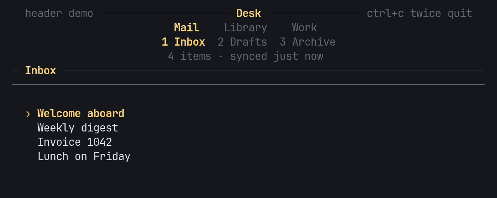</p>

`pito_tui::header` is the top of a [PITO MD](https://pitomd.com) terminal
app, drawn with [ratatui](https://ratatui.rs) 0.30: groups of numbered
sections in two nested rows, drill-in with a breadcrumb, and optional title,
facts and notice rows, all abbreviating to fit the width. It has no app logic
and no words of its own: the app passes in every name, every style and every
key. The shell draws it on every screen; an app with its own loop draws it on
its own.

### Header at a glance

| | |
|---|---|
| Full header, drawn at 150 columns | **8.7 µs** a frame (mean of 200,000) |
| Nav rows alone / a click hit-test | **2.1 µs** / **0.11 µs** |
| Allocations while drawing or hit-testing | **0** (a counting allocator in the tests holds it) |
| Size | **about 1,570 lines** of Rust, 110 tests |

Measured on 2026-10-14 on an AMD Ryzen 9 9950X with Rust 1.97.1:
`cargo run --release --example header_bench 200000` for the times. The chart
under [Fast](#fast) has every case.

### A first header

The header comes with pito-tui's one line
([Install and first use](#install-and-first-use)). Build a nav, feed it keys
and draw it:

```rust,standalone_crate
use pito_tui::header::{Group, Header, Key, Nav, Section};
use pito_tui::ratatui::{Frame, layout::Rect};

let mut nav = Nav::new(vec![
    Group::new("Mail").section(Section::new("Inbox")).section(Section::new("Drafts")),
    Group::new("Work").section(Section::new("Checks")),
]);
nav.key(Key::Char('3'));
assert_eq!(nav.place().number, 3);

fn draw(frame: &mut Frame, nav: &Nav) {
    let area = frame.area();
    let header = Header::new(nav).title(Some("Desk"));
    frame.render_widget(header, Rect { height: header.height(), ..area });
}
```

To see it move, run the demo at the top of this part from a checkout:

```sh
cargo run --example header_demo
```

`tab` and `shift+tab` change group, `]` and `[` change section, a digit
jumps to a section, `enter` drills in, `esc` goes back and `ctrl+c` pressed
twice quits.

### Groups and numbered sections

Sections are numbered 1, 2, 3… across all groups, so a digit jumps anywhere
(`0` is the tenth). The groups row sits over the current group's sections,
centred, the current one in the accent and bold, and every group remembers
its section. The GIF at the top of this part is `examples/header_demo.rs`.

Keys map to actions, and nothing is taken behind the app's back:
`action(key)` only looks, `apply(action)` moves, and `key(key)` does both.
Every key set is configurable through `NavKeys` (`NavKeys::NONE` takes
nothing), so `tab`, `[ ]`, digits or `q` can keep other meanings in an app,
and back at the top level is never an action, so `esc` stays the app's there.

### Fits any width

<p align="center">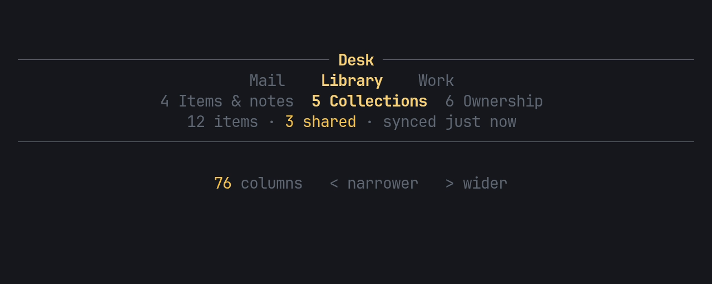</p>

When the width runs out, the rows abbreviate step by step and never wrap:
full names, then each section's short name, then only the current one named,
then numbers only. A group falls back to its short name, then its first
letter. Facts elide with "…", and the title's side slots drop before the
title does. Widths are measured per cell with Unicode widths, so diacritics
(ă, î, ș, ț), "…" and wide glyphs clip cleanly. This is
`examples/header_fit.rs`.

### Drill-in with a breadcrumb

<p align="center">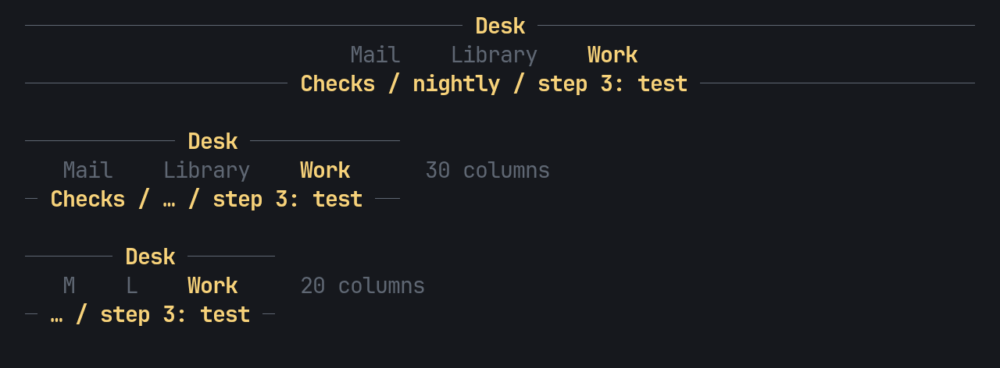</p>

`open(title, selected)` goes one level deeper and remembers the list's
selection; back returns it, so the list comes back where it was. Each section
keeps its own stack while you move around. While drilled in, the header
swaps the sections row for a breadcrumb rule, as HEY's terminal UI does, and
the breadcrumb elides its middle, then its head, when it doesn't fit.

```rust,standalone_crate
use pito_tui::header::{Drill, Group, Header, Nav, Section};

let mut nav = Nav::new(vec![
    Group::new("Library").section(Section::new("Ownership")),
    Group::new("Work").section(Section::new("Checks")),
]);
nav.open("build queue", 3);
assert_eq!(Header::new(&nav).crumbs(true).height(), 2);
assert_eq!(Header::new(&nav).crumbs(true).drill(Drill::Rows).height(), 3);
assert_eq!(nav.back(), Some(3));
```

Back brings the sections row back with the selection kept, and clicks on the
breadcrumb rule hit nothing. An app that wants the breadcrumb on a row of its
own passes `.drill(Drill::Rows)`; the `Breadcrumb` widget stays for apps
that title their own content.

### Every row is optional

<p align="center">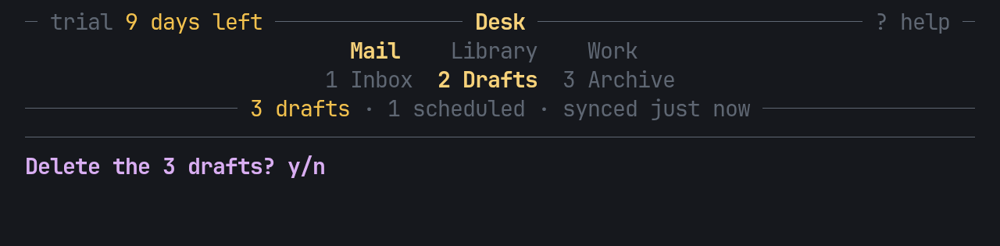</p>

`Header` draws only the rows it's given: a title rule with the name in the
middle and a left and a right slot, the nav rows, a facts row (on a rule or
plain, each fact styled by the app), a closing rule, and a notice row for a
result, a warning or a confirm question. A slot can hold several styles side
by side (`left_parts`), and text on a rule carries exactly its own style: the
rule's DIM never leaks into it. A header with no sections (a dashboard)
draws only its other rows. This is `cargo run --example header_gallery -- rows`.

### Sections in several styles

<p align="center">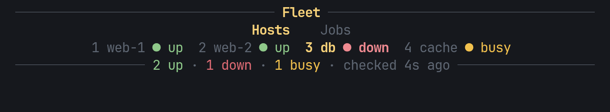</p>

`Section::spans` gives a section several styled spans, such as a host's name
next to its state, and `section_mut(..).set_spans(..)` changes it in place
while the app runs, keeping the place, every group's remembered section and
every drill stack. Each span draws over the cell's style, so the current
section keeps its accent and bold. This is
`cargo run --example header_gallery -- spans`.

### Clicks

The header never reads the mouse; it answers where a click landed.
`hit(area, column, row)` names the group or section under the pointer, and
nothing outside the area:

```rust,standalone_crate
use pito_tui::header::{Header, Nav};
use pito_tui::ratatui::layout::Rect;

fn click(nav: &mut Nav, area: Rect, column: u16, row: u16) {
    let place = Header::new(nav).title(Some("Desk")).hit(area, column, row);
    if let Some(place) = place {
        nav.go_to(place.group, place.section);
    }
}
```

### Fast

<p align="center">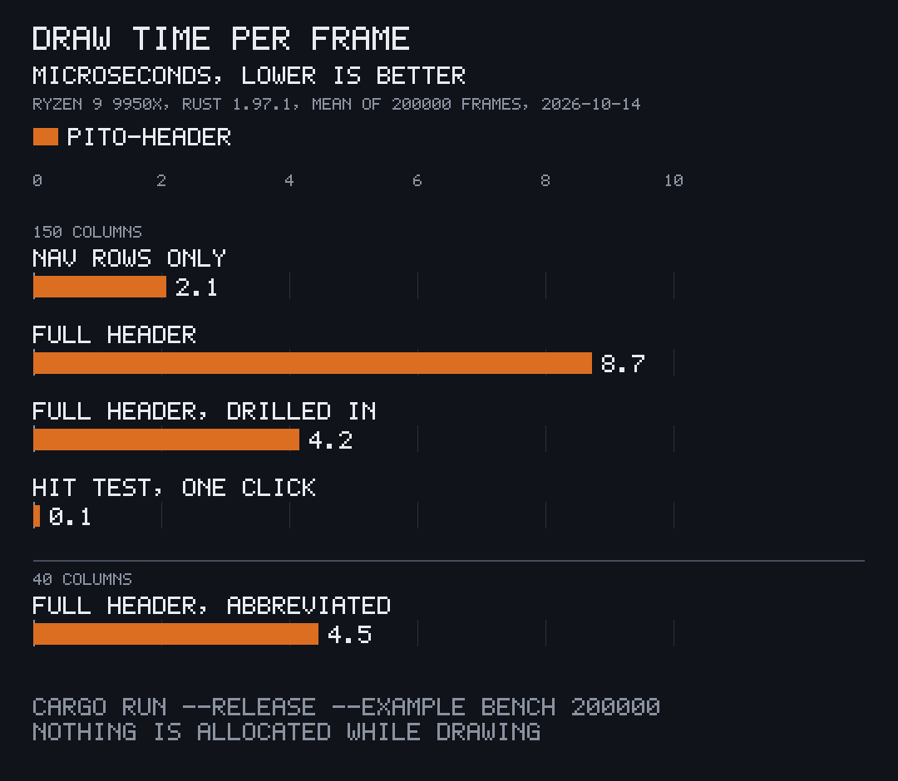</p>

Drawing writes straight into ratatui's buffer: no allocation, no clock, no
input and no randomness, so a frame costs microseconds and the same state
always draws the same cells. Run `cargo run --release --example header_bench
200000` for these numbers on your machine; the chart is drawn by
[pito-compare](https://github.com/gmrdad82/pito-compare) from
[docs/images/header/draw-time.toml](docs/images/header/draw-time.toml).

### Header behaviour in detail

- **Digits past the last section** do nothing and fall through to the app,
  unless `swallow_digits` is on: then they map to `Action::Swallow`, which
  `apply` answers with `Step::Swallowed`, so the key is taken and nothing
  moves. Off by default, and only while `digits` is on.
- **`zero_first`** numbers the sections from `0`: `0` jumps to the first,
  `1` to `9` to the second through the tenth, and the labels show the same
  digits. Sections past the tenth have no digit and no number on their
  label; `]`, `[` and the group keys still reach them. Off by default, when
  `0` is the tenth.
- **`cycle(by)` and `step(by)`** move by the size of `by` (negative goes
  back) and wrap. `cycle` counts filled groups only and answers `None` when
  there is no other group to go to; `cycle(0)` and `step(0)` stay where they
  are and answer the place. With a single group, `tab` steps sections.
- **`selected(group)`** reads any group's remembered section, so the app can
  jump to a group at its remembered section with `go_to(group, section)`.
- **Texts the app owns as `String`s:** `facts_pairs`, `left_pairs` and
  `right_pairs` take a slice of `(String, Style)` and draw it like the
  `Fact` forms, so the app needs no parallel `Vec<Fact>` each frame.
- **Empty facts are skipped,** and a row of only empty facts takes no row.
  The row elides with "…" only when the room left cannot hold the separator
  and the next fact's first two cells; a cut fact ends the row. An empty
  `title` is no title. When a slot is cut, the ellipsis takes the style of
  the part it cuts.
- **Control characters take no cell:** a newline, tab or carriage return
  inside a text is drawn as one space, and one at either end is dropped, so
  a multi-line message reads as one line.
- **`lit(false)`** keeps the group lit but dims the current section, for a
  page that sits over every section (help, settings). `underline(true)`
  underlines the section numbers.
- **`Key::from(crossterm::event::KeyEvent)`** (crossterm 0.29, as
  `pito_tui::crossterm`) keeps Alt apart (`Key::Alt('q')` is not
  `Key::Char('q')`, so Alt+q is not Back), turns Alt, Super, Meta or Hyper
  on any other key into `Key::Other`, and passes Ctrl+Alt plus a character
  on as that character, which is how AltGr arrives on some platforms, so
  diacritics can still be typed.

### The header's API

```text
pub enum Key { Char(char), Ctrl(char), Alt(char), Tab, BackTab, Enter, Esc, Backspace,
               Left, Right, Up, Down, Other }          // non_exhaustive
pub struct Styles { accent, muted, rule }              // plain fields; Styles::new() and the builders are the stable way to build it
Section::new(name).short(short)
Section::spans(&[(text, Style)]).short(short)          // one label in several styles
Section::spans(..).short_spans(&[(text, Style)])         // the abbreviation in several styles
  section.set_name(..), set_spans(..), set_short(..), set_short_spans(..)   // change a label in place
Group::new(name).short(short).section(section)
Nav::new(groups).keys(NavKeys)
  place() -> Place { group, section, number }          // number is 1-based, 0 when empty
  selected(group) -> Option<usize>                     // the section a group remembers
  section(), section_mut(group, section) -> Option<&mut Section>
  count(), go(number), go_to(group, section), cycle(by), step(by)
  open(title, selected), back() -> Option<usize>, close() -> Option<usize>
  depth(), title(), crumbs(), breadcrumb() -> String
  action(Key) -> Option<Action>, apply(Action) -> Option<Step>, key(Key) -> Option<Step>
pub enum Action { NextGroup, PrevGroup, NextSection, PrevSection, Go(usize), Back, Swallow }   // non_exhaustive
pub enum Step { Moved(Place), Back { selected }, Swallowed }                                   // non_exhaustive
NavKeys { next_group, prev_group, next_section, prev_section, back: &'static [Key], digits,
          swallow_digits, zero_first }                 // non_exhaustive; digits past the last section are taken
  NavKeys::HEY: tab / backtab, ] / [, digits, esc / q          NavKeys::NONE
  .next_group(..) .prev_group(..) .next_section(..) .prev_section(..) .back(..)   // const builders
  .digits(bool) .swallow_digits(bool) .zero_first(bool)
NavBar::new(&nav).styles(..).lit(bool).groups(bool).underline(bool); height(), hit(..)
Breadcrumb::new(&nav).styles(..).centred(bool)
Fact::new(text, style)
pub enum Drill { Replace, Rows }                       // Replace by default; non_exhaustive
Header::new(&nav).styles(..).title(..).left(..).right(..).tabs(bool).lit(bool)
  .left_parts(&[Fact]).right_parts(&[Fact])           // a slot in several styles
  .left_pairs(&[(String, Style)]).right_pairs(&[(String, Style)]).facts_pairs(&[(String, Style)])
  .underline(bool).facts(&[Fact]).facts_rule(bool).separator(..).crumbs(bool)
  .closing(bool).notice(Option<Fact>).drill(Drill); height(), hit(..)
```

Every public enum, and `NavKeys`, are `#[non_exhaustive]`: match them with a
wildcard arm, and build a `NavKeys` from `HEY` or `NONE` and its methods, so a
later release can add to them in a minor version.

### A fuller header

```rust,standalone_crate
use pito_tui::header::{Fact, Group, Header, Key, Nav, Section, Step, Styles};
use pito_tui::ratatui::{Frame, layout::Rect, style::{Color, Modifier, Style}};

fn nav() -> Nav {
    Nav::new(vec![
        Group::new("Mail").section(Section::new("Inbox")).section(Section::new("Drafts")),
        Group::new("Library").section(Section::new("Items & notes").short("Items")),
    ])
}

fn key(nav: &mut Nav, key: Key, selected: &mut usize) {
    match nav.key(key) {
        Some(Step::Back { selected: kept }) => *selected = kept,
        Some(Step::Moved(_)) => *selected = 0,
        Some(Step::Swallowed) => {}
        Some(_) => {}
        None if key == Key::Enter => nav.open(format!("item {selected}"), *selected),
        None => {}
    }
}

fn draw(frame: &mut Frame, nav: &Nav) {
    let dim = Style::new().add_modifier(Modifier::DIM);
    let styles = Styles::new().accent(Style::new().fg(Color::Magenta)).muted(dim).rule(dim);
    let facts = [Fact::new("12 items", dim), Fact::new("synced just now", dim)];
    let header = Header::new(nav)
        .styles(styles)
        .title(Some("Desk"))
        .right(Some(Fact::new("? help", dim)))
        .facts(&facts)
        .crumbs(true);
    let area = frame.area();
    frame.render_widget(header, Rect { height: header.height(), ..area });
}
```

The [header's guides](docs/pages/header/index.md) take one task a page.

## The footer

<p align="center">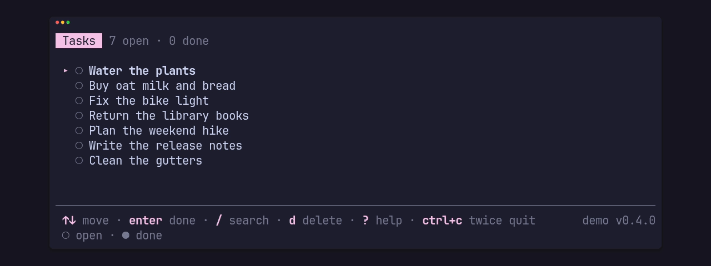</p>

`pito_tui::footer` is the bottom of a [PITO MD](https://pitomd.com) terminal
app, drawn with ratatui 0.30: key hints that fit the width, a notice line, a
y/n confirm, a one-line input, a quit guard and the app's version. The look is
in the style of HEY's terminal UI. It has no app logic and no words of its
own: the app passes in every hint, every word, every key and every style, so
any language works. The shell assembles it on every screen; an app with its
own loop draws it on its own.

- **8.4 µs** to draw a row of twelve hints with a notice at 150 columns, and
  **38.5 µs** for a frame that draws every widget the footer has: 0.23% of a
  60 fps frame.
- **Zero allocations** while drawing: a counting allocator in the tests holds it.
- **2,357 lines** of Rust.

### A first footer

The footer comes with pito-tui's one line
([Install and first use](#install-and-first-use)). Then put hints at the
bottom of the screen:

```rust,no_run,standalone_crate
use pito_tui::crossterm::event;
use pito_tui::footer::{Footer, Hint};
use pito_tui::ratatui::layout::Rect;

const HINTS: [Hint; 3] = [
    Hint::new("↑↓", "move"),
    Hint::new("enter", "open").rank(1),
    Hint::new("q", "quit").pinned(),
];

fn main() -> std::io::Result<()> {
    let mut terminal = pito_tui::ratatui::init();
    loop {
        terminal.draw(|frame| {
            let footer = Footer::new(&HINTS).version("app", "1.0.0");
            let area = frame.area();
            let height = footer.height(area.width);
            let bottom = Rect { y: area.bottom().saturating_sub(height), height, ..area };
            frame.render_widget(footer, bottom);
        })?;
        let quit = event::read()?
            .as_key_press_event()
            .is_some_and(|key| key.code == event::KeyCode::Char('q'));
        if quit {
            break;
        }
    }
    pito_tui::ratatui::restore();
    Ok(())
}
```

To see every part working, run the demo above from a checkout, a task list
with the footer at its bottom:

```sh
cargo run --example footer_demo
```

`Key::from(crossterm::event::KeyEvent)` (crossterm 0.29, as
`pito_tui::crossterm`) turns a key event into the footer's `Key`; drawing
needs no backend. The conversion keeps Alt apart (`Key::Alt('y')` is not
`Key::Char('y')`, so Alt+y does not answer Yes), turns Alt, Super, Meta or
Hyper on any other key into `Key::Other`, and passes Ctrl+Alt plus a
character on as that character, which is how AltGr arrives on some platforms,
so diacritics can still be typed.

### Hints that fit the width

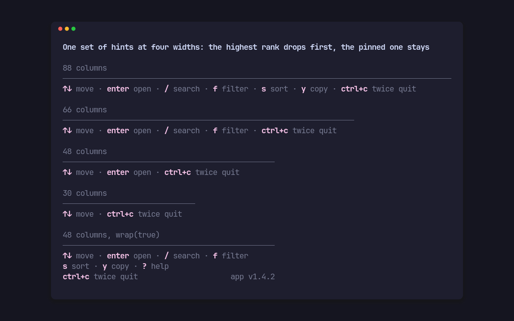

Each `Hint` is a key, a label and a rank. When the width runs out the highest
rank drops first, the order is kept and a pinned hint goes last of all; the
app's version, when it has one, goes before any hint. `wrap(true)` flows every
hint over as many rows as it needs instead, and `height(width)` says how many
rows to give it. `shown(key, width)` tells the app whether a key's hint is on
screen, so it can accept only the keys it shows. `?` shows or hides the hints
through `Help`.

### A notice line

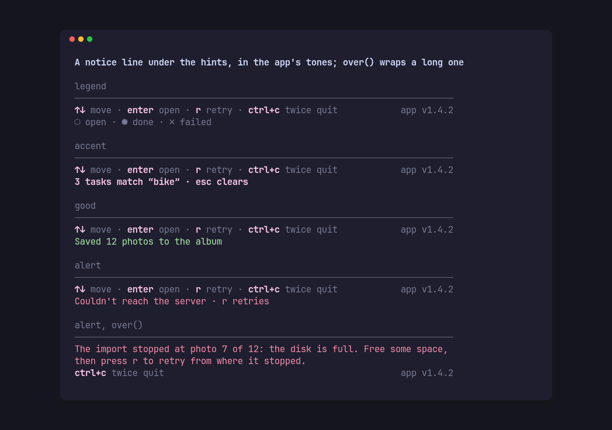

Under the hints sits one line for a legend, a result or a warning, in the
app's ink, muted, accent, alert or good style. A notice marked `over()` that is
too long for one row takes the hint rows' place and wraps across them, and the
pinned hints stay on the last row under it.

### A status row

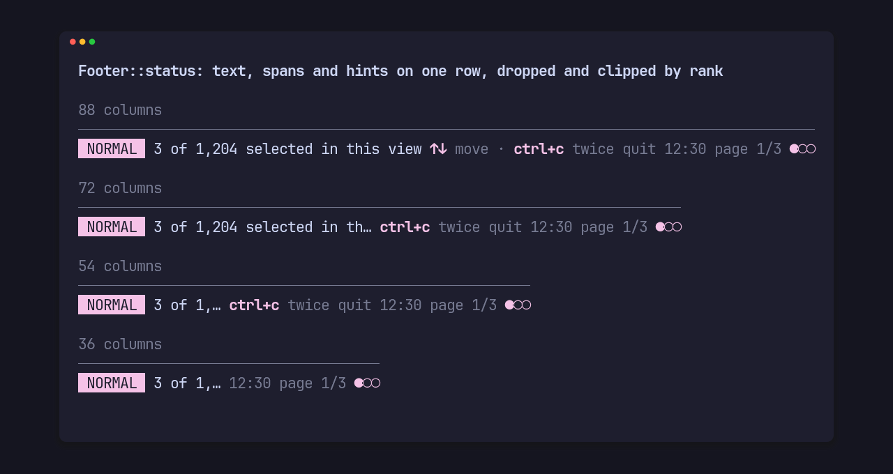

`Footer::status` lays out text, styled spans and hints on one row, left or right
aligned. The highest rank drops first, a segment marked `shrink()` is clipped
to the space left with one "…", and `Segment::spans` keeps several styles in
one segment, so a percentage or page dots carry their own colour.

### A one-line input, and a masked one for keys


`Input` edits by grapheme and cell, so diacritics, combining marks and wide
glyphs move and delete whole: left and right, home and end, ctrl+a and ctrl+e,
backspace and delete, ctrl+u and ctrl+w, and a bracketed paste kept on one
line. `InputBar` draws the label, the text with its caret and the hint, and
scrolls with "…" at either cut end to keep the caret in view.
`Input::masked(true)` draws every character as `•` and never reveals anything
while the user types; a stored key shown at rest can opt in to its ends with
`reveal_ends(n)`.

### A confirm, and a quit guard

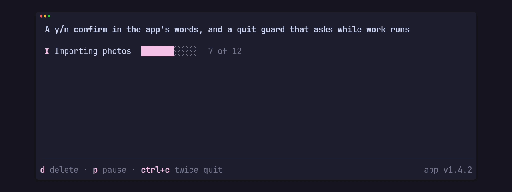

`ConfirmBar` draws "Question?  Yes   ▸ No" in the app's words, over a hint line
or inline, and `Confirm` returns the answer and never runs anything. The
`QuitGuard` arms on the first ctrl+c, shows the app's "again" notice and quits
on a second press inside the window; in `Mode::Ask` it asks through a confirm
first while the app says work is running. Every `key` call says what happened,
and the footer never reads input, the clock or the mouse itself.

### Footer speed

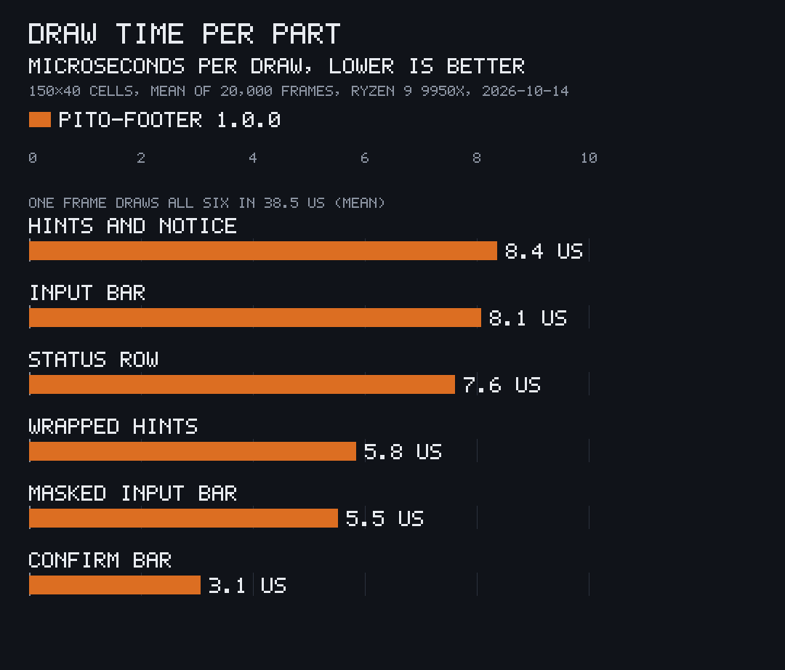

Drawing writes straight into ratatui's buffer and allocates nothing. The chart
is `cargo run --release --example footer_bench`: 20,000 frames into a 150×40
buffer, each drawing twelve hints with a notice, a status row of five
segments, the hints wrapped at 60 columns, a confirm bar, an input bar holding
diacritics and wide glyphs, and a masked input bar, timing each part. Measured
once on 2026-10-14 on an AMD Ryzen 9 9950X under Linux with Rust 1.97.1,
release profile, while other renders ran on the machine: a mean of 38.5 µs a
frame for all six. The chart
is drawn with [pito-compare](https://github.com/gmrdad82/pito-compare) from
[render/footer/render/bench.toml](render/footer/render/bench.toml).

| | |
|---|---|
| Frame of all six parts, mean | 38.5 µs |
| Allocations while drawing | 0 |
| Lines of Rust in `src/footer/`, blank lines left out | 2,357 |

### Every footer feature in detail

- **Key hints, declared per screen.** Each `Hint` is a key, a label, an
  optional lead word ("Press ctrl+c again to quit") and a rank. When the
  width runs out the highest rank drops first (the later one on a tie),
  order is kept, and a pinned hint goes last of all.
- **Or wrap:** `wrap(true)` flows every hint over as many lines as it
  needs; `height(width)` says how many rows to give it.
- **`?` shows or hides the hints** through `Help` (any key can be the
  toggle); pinned hints and the notice stay. An app whose `?` opens a help
  page instead just doesn't use `Help`.
- **A notice line** under the hints for a legend, a result or a warning, in
  the app's ink, muted, accent, alert or good. A notice marked `over()` that's too
  long for one row takes the hint rows' place and wraps across them; the
  pinned hints stay on the last row under it, `height(width)` counts that row,
  and `shown(key, width)` still answers true for a pinned hint.
- **A good tone** for success: `Tone::Good` and `Notice::good(text)` use
  `Styles::good`, and fall back to the ink style until the app sets one.
- **An indent:** `indent(n)` insets the hints, the notice and the confirm by
  `n` cells while the rule stays full width; hints drop and wrap within the
  inset width.
- **Text keeps its own style:** the rules are rows of their own, so no hint,
  notice, confirm or segment ever picks up the rule's modifiers, such as DIM.
- **Control characters take no cell:** a newline, tab or carriage return
  inside a text is measured and drawn as one space between its two sides, and
  one at either end is dropped, so a multi-line message reads as one line.
- **Keys follow display:** `shown(key, width)` says whether a key's hint is
  on screen now, so an app can accept only the keys it shows.
- **Footer segments with drop priority:** `Footer::status` lays out text
  and hint segments on one row, left or right aligned; the highest rank
  drops first, shrinkable segments are clipped to the space left, and the
  hints are just one segment among them.
- **Status spans:** `Segment::spans(&[(text, Style)])` is one text segment in
  several styles, so a percentage or page dots carry their own colour; it
  measures, drops and shrinks as one segment and clips with one ellipsis in
  the style of the span it cuts. `Segment::text(text, style)` still works.
- **The app's version:** `version(name, version)` draws `name v1.2.3` in the
  muted style at the right end of the row of keys: the hint row (the last one
  when hints wrap, the status row of `Footer::status` right of every segment),
  or the hint line of a carried confirm or input, else that bar's only row.
  It takes only the room nothing else needs: it is never clipped and never
  pushes out a hint or a segment, so it is the first thing to go, whole, when
  the width runs out. When hints wrap, the last hint moves down a row rather
  than leave it no room; when `?` hides every hint, it keeps a row of its own;
  under an over notice it stays on the last row. `height(width)` counts those
  rows and `shown` is unchanged. A version that starts with `v` keeps its own,
  an empty name draws just `v1.2.3`, and without a version nothing is drawn.
  A right-aligned `Segment::text` can show a version too, but it takes its
  cells from the hints by rank, or is clipped when it shrinks.
- **A confirm, in the bottom bar or a notice row.** `Confirm` holds the
  choice (No unless the app starts it on Yes); `ConfirmKeys` sets the yes and
  no keys, the keys that switch the choice (`toggle`) and the keys that accept
  it (`accept`) (`HEY`: y/n, arrows, tab, h/l and enter, esc cancels; `ENTER`:
  enter accepts, esc cancels). `ConfirmBar` draws "Question?  Yes   ▸ No"
  over a hint line, or inline on one row, in the app's words, and the footer
  can carry it in place of the hints, keeping the bar's own styles if it has
  any. When the width is short the question is clipped last: the choices go
  before it does. It returns the answer and never runs anything.
- **A one-line input.** `Input` holds the text and the cursor; the app
  feeds it keys and gets an `Edit` back: `Changed` when the text changed,
  `Held` for a key it used without a change (a move), `Submit(text)` on
  enter, `Cancel` on esc, and `Pass` for every key that isn't the input's,
  such as ctrl+c or tab. It never submits, clears or closes anything itself.
  Editing is by grapheme and cell: left/right, home/end and ctrl+a/ctrl+e,
  backspace and delete, ctrl+u (to the start) and ctrl+w (the word before the
  cursor), so diacritics, combining marks and wide glyphs move and delete
  whole. `paste(text)` takes a bracketed paste and keeps it on one line (a
  newline, a carriage return or a pair of them each become one space).
  `limit(chars)` caps the value's length: a paste or key past it is cut or
  held, and `set` truncates.
- **An input bar.** `InputBar` draws the app's label, then the text with a
  reversed caret cell, or the app's placeholder while empty, scrolling with
  "…" at either cut end to keep the caret in view; an optional rule above and
  hint line below, like the confirm. `cursor(area)` says where the caret is,
  for an app that shows the terminal's own cursor (`caret(false)` drops the
  drawn one). The footer can carry it in place of the hints.
- **A masked input for keys:** `Input::masked(true)` draws every character as
  `•` (or the app's `mask`), and never reveals anything while the user types
  or edits. A stored value shown at rest can opt in to its ends:
  `InputBar::reveal_ends(n)` draws the first and last `n` characters of an
  input that was set with `with` or `set` and not edited since
  (`Input::edited()`), and only when it has at least four times `n` characters,
  so the revealed share stays a quarter or less. The value stays whole for
  `Submit`, and neither `Input`'s nor `Edit`'s `Debug` prints it.
- **A quit guard with modes:** `Twice` (the first press arms and shows the
  app's "again" notice, a second inside the window quits, any other key
  disarms), `Ask` (the same, but while the app says work is running the
  second press asks through a confirm first) and `Once` (quit at once). The
  trigger keys, the window (2 s by default) and the wording are the app's.
  A screen that passes every key through (an embedded terminal) simply
  doesn't hand its keys to the guard.
- **Nothing is taken behind the app's back:** every `key` call returns what
  happened (`Guard::Pass` means the key is the app's), and the footer never
  reads input, the clock or the mouse itself. `deadline()` tells the event
  loop when the armed notice ends.
- **Widths by cell:** Unicode widths throughout, so diacritics (ă, î, ș, ț),
  "…" and wide glyphs measure and clip cleanly.
- **Cheap:** drawing writes straight into the buffer, with no allocation;
  see [Footer speed](#footer-speed).

### The footer's API

```text
pub enum Key { Char(char), Ctrl(char), Alt(char), Tab, BackTab, Enter, Esc, Backspace,
               Left, Right, Up, Down, Home, End, Delete, Other }   // non_exhaustive
pub struct Styles { accent, muted, alert, ink, rule, good }   // non_exhaustive; Styles::new().accent(..)
                                         // good: Option<Style>, ink until set
pub enum Tone { Ink, Muted, Accent, Alert, Good }   // non_exhaustive
Hint::new(key, label).rank(u8).lead(text).pinned()   // Hint, Notice, Segment, Part, Words,
                                                      // Wording, Edit, Answer, Mode, Guard: non_exhaustive
Notice::new(text, tone) | legend(text) | accent(text) | alert(text) | good(text); .over()
Help::new(open).toggle_on(Key); open(), toggle(), wants(Key), key(Key) -> bool
Segment::text(text, style) | spans(&[(text, Style)]) | hints(&[Hint]);
  .rank(u8).right().shrink()
Footer::new(&[Hint]) | status(&[Segment])
  .notice(Option<Notice>).confirm(Option<ConfirmBar>).input(Option<InputBar>)
  .separator(..).gap(u16).open(bool).help(&Help).rule(bool).wrap(bool)
  .indent(u16).styles(..).version(name, version)   // "name v1.2.3", dim, right end
  height(width), shown(key, width), cursor(area) -> Option<Position>
ConfirmKeys { yes, no, toggle, accept: &'static [Key], choose }   // non_exhaustive
  ConfirmKeys::HEY, ConfirmKeys::ENTER; .yes(..) .no(..) .toggle(..) .accept(..) .choose(bool)
Confirm::new().keys(..).start(Answer); yes(), choosing(), key(Key) -> Option<Answer>
Words::new(yes, no).hint(text)
ConfirmBar::new(question, &confirm, words).rule(bool).inline(bool).tone(Tone).styles(..)
pub enum Edit { Pass, Held, Changed, Submit(String), Cancel }
Input::new().masked(bool).limit(chars).with(text); value(), cursor(), is_empty(),
  is_masked(), edited(), set(text), clear(), key(Key) -> Edit, paste(text) -> Edit
InputBar::new(label, &input).placeholder(text).hint(text).mask(glyph).reveal_ends(n)
  .rule(bool).caret(bool).tone(Tone).styles(..); height(), cursor(area)
Wording::new(again).ask(question)
QuitGuard::new(wording).mode(Mode).window(Duration).triggers(&[Key]).confirm(Confirm)
  key(Key, now, busy) -> Guard { Pass, Held, Quit }
  tick(now) -> bool, deadline(), armed(), notice(), asking(), bar(words), cancel()
```

Every public enum and options struct is `#[non_exhaustive]`: match enums with a
wildcard arm, and build `Hint`, `Notice`, `Segment`, `Words`, `Wording`,
`Styles` and `ConfirmKeys` with their constructors and methods, so a later
release can add to them in a minor version.

### A footer example

The demo at the top of this part is `examples/footer_demo.rs`: move with ↑↓,
mark a task done with enter, search with `/`, delete with `d`, hide the hints
with `?`, and press ctrl+c twice to quit. `examples/footer_gallery.rs` draws
the other pictures here, one scene each
(`cargo run --example footer_gallery -- fit`, or `notices`, `status`, `input`,
`confirm`). The core of an app's footer looks like this:

```rust,standalone_crate
use std::time::Instant;
use pito_tui::footer::{Footer, Guard, Help, Hint, Key, Mode, Notice, QuitGuard, Styles, Words, Wording};
use pito_tui::ratatui::{Frame, layout::Rect, style::{Color, Modifier, Style}};

const HINTS: [Hint; 4] = [
    Hint::new("↑↓", "move"),
    Hint::new("enter", "open").rank(1),
    Hint::new("/", "search").rank(2),
    Hint::new("ctrl+c", "twice quit").pinned(),
];

fn guard() -> QuitGuard {
    QuitGuard::new(Wording::new("ctrl+c again to quit").ask("Work is running. Quit anyway?"))
        .mode(Mode::Ask)
}

fn key(guard: &mut QuitGuard, help: &mut Help, key: Key, busy: bool) -> bool {
    match guard.key(key, Instant::now(), busy) {
        Guard::Quit => true,
        Guard::Held => false,
        _ => {
            help.key(key);
            false
        }
    }
}

fn draw(frame: &mut Frame, guard: &QuitGuard, help: &Help) {
    let dim = Style::new().add_modifier(Modifier::DIM);
    let styles = Styles::new().accent(Style::new().fg(Color::Magenta)).muted(dim).rule(dim);
    let words = Words::new("Yes", "No").hint("y/n choose · enter accept · esc cancel");
    let footer = Footer::new(&HINTS).styles(styles).help(help)
        .version("app", env!("CARGO_PKG_VERSION"))
        .notice(guard.notice().map(Notice::accent))
        .confirm(guard.bar(words));
    let area = frame.area();
    let height = footer.height(area.width);
    frame.render_widget(footer, Rect { y: area.bottom().saturating_sub(height), height, ..area });
}
```

### An input prompt

```rust,standalone_crate
use pito_tui::footer::{Edit, Footer, Hint, Input, InputBar, Key, Styles};
use pito_tui::ratatui::{Frame, layout::Rect};

const HINTS: [Hint; 1] = [Hint::new("/", "search")];

fn key(input: &mut Option<Input>, key: Key) -> Option<String> {
    let field = input.as_mut()?;
    match field.key(key) {
        Edit::Submit(text) => {
            *input = None;
            Some(text)
        }
        Edit::Cancel => {
            *input = None;
            None
        }
        _ => None,
    }
}

fn draw(frame: &mut Frame, input: Option<&Input>, styles: Styles) {
    let bar = input.map(|input| {
        InputBar::new("Search", input)
            .placeholder("type to filter")
            .hint("enter search · esc cancel")
    });
    let footer = Footer::new(&HINTS).styles(styles).input(bar);
    let area = frame.area();
    let height = footer.height(area.width);
    let area = Rect { y: area.bottom().saturating_sub(height), height, ..area };
    frame.render_widget(footer, area);
}
```

A bracketed paste arrives as its own event, not a key: hand its text to
`Input::paste`.

The [footer's guides](docs/pages/footer/index.md) take one task a page.

## The hourglass

<p align="center">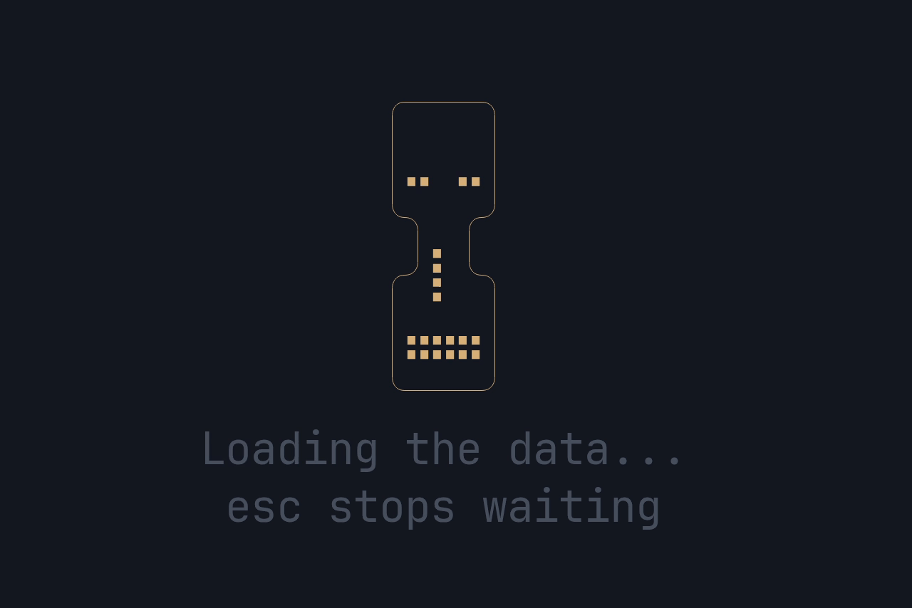</p>

`pito_tui::hourglass` is an hourglass for ratatui apps to show while data
loads: HEY's 13-frame Braille hourglass, the app's copy (the label)
shimmering under it in the app's accent, and an optional hint under that. One
widget, one call a frame. The shell shows it while a screen loads; an app with
its own loop draws it on its own.

- **4.8 µs a draw** with the glass, the label and the hint, under 0.03% of a
  60 fps frame; 1.0 µs on a single row ([how it's measured](#fast-and-allocation-free)).
- **Zero allocations** when it draws, held by a counting-allocator test in
  the gate.
- **Small:** one 284-line source file and a 96-byte `Copy` widget.

### A first hourglass

The hourglass comes with pito-tui's one line
([Install and first use](#install-and-first-use)). Draw it from the time the
wait started:

```rust,standalone_crate
use std::time::Instant;

use pito_tui::hourglass::Hourglass;
use pito_tui::ratatui::{
    Frame,
    style::{Color, Modifier, Style},
};

fn draw(frame: &mut Frame, started: Instant) {
    let hourglass = Hourglass::new(started.elapsed())
        .label("Loading the data...")
        .hint(Some("esc stops waiting"))
        .glass(Style::new().fg(Color::Yellow))
        .accent(Style::new().fg(Color::Magenta))
        .muted(Style::new().fg(Color::DarkGray).add_modifier(Modifier::DIM));
    frame.render_widget(hourglass, frame.area());
}
```

Redraw about every 50 ms while it shows; the picture depends only on the
elapsed time. That code is
[examples/hourglass_demo.rs](examples/hourglass_demo.rs), the clip at the top
of this part. From a checkout, Esc or q quits:

```sh
cargo run --example hourglass_demo
```

### Your copy, your accent, any script

<p align="center">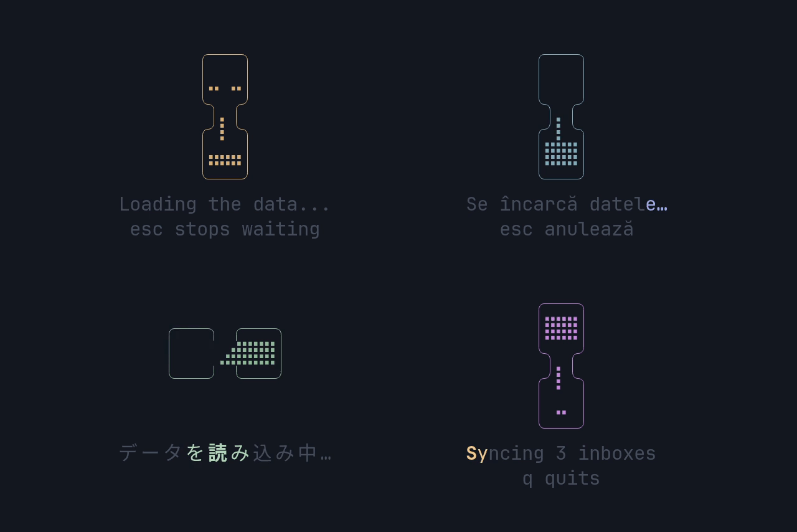</p>

Every word and every style is the app's: the label, the hint, the glass, the
accent the label shimmers in and the muted colour of the rest. A
three-character band sweeps across the label and pauses: its centre character
is the accent plus bold, its two neighbours the accent, everything else
muted. The hint never shimmers. Widths come from Unicode, so Romanian
diacritics, "…" and two-cell CJK glyphs line up and centre exactly
([examples/hourglass_gallery.rs](examples/hourglass_gallery.rs)).

### Fits whatever space it gets

<p align="center">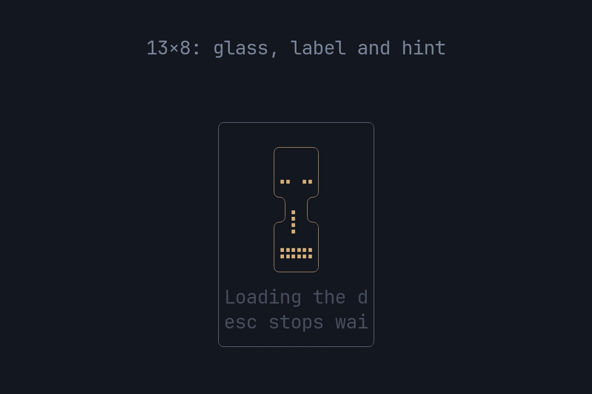</p>

- **Room for everything** (at least 11 cells wide and 7 rows high, 8 with a
  hint): the glass, the label and the hint are centred as one block.
- **Less room:** the glass goes and the shimmering label stays, centred, with
  the hint on the next row when there is a second row.
- **Long copy is cut at a character,** never mid-glyph (a combining mark
  rides with its letter), and the band counts only the characters drawn, so a
  cut label still shimmers end to end.
- **No room at all** (a zero width or height): nothing is drawn.

The clip is [examples/hourglass_fit.rs](examples/hourglass_fit.rs).

### A picture of the time alone

<p align="center">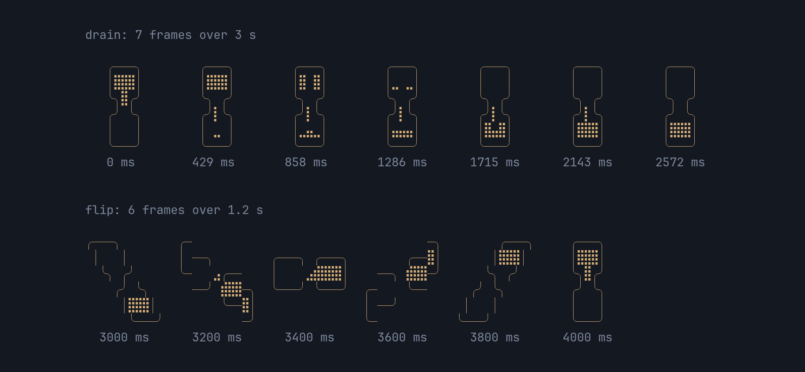</p>

The frame and the band are pure functions of the elapsed time, so a redraw
at any moment lands on the same picture, and nothing keeps state between
frames. The still is [examples/hourglass_frames.rs](examples/hourglass_frames.rs),
drawn with `frame_at` itself.

```text
frame_at(elapsed)   e = elapsed mod CYCLE (4200 ms)
                    e <  3000: frame = floor(e * 7 / 3000)            the 7 drain frames, ~430 ms each
                    e >= 3000: frame = 7 + floor((e - 3000) * 6 / 1200)  the 6 flip frames, 200 ms each

band_at(elapsed, n) t = elapsed mod 1500 ms
                    t <  1200: centre = floor(t * (n + 4) / 1200) - 2
                    t >= 1200: None, the pause
```

`band_at` returns the centre's index into the `n` characters of the label,
and `None` whenever the centre is off the label (below 0, or at `n` or
beyond) and through the pause. The sweep starts two characters before the
label and ends two after it, so the band slides in and out.

### Fast and allocation-free

<p align="center">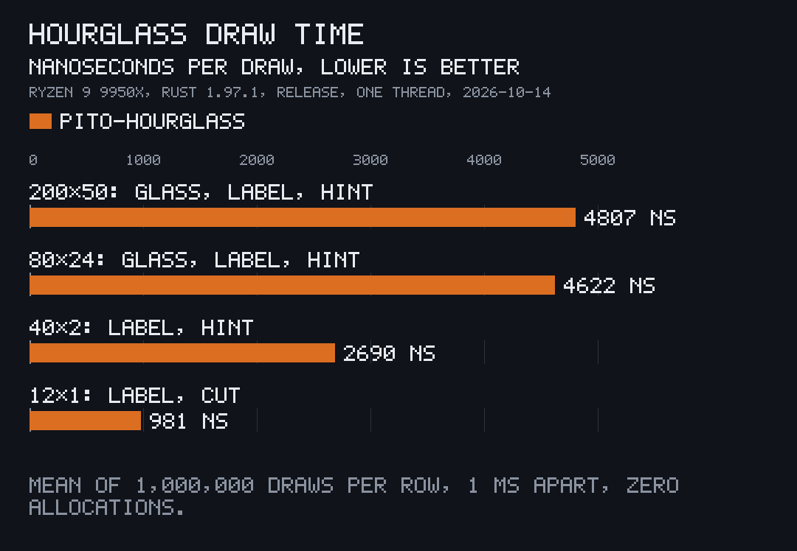</p>

[examples/hourglass_bench.rs](examples/hourglass_bench.rs) draws the widget
into a ratatui `Buffer` a million times per size, 1 ms of elapsed time apart
(so every frame and band position comes round), after a warm-up, and prints
the mean time per draw as [pito-compare](https://github.com/gmrdad82/pito-compare)
data. Measured once, on 2026-10-14, on an AMD Ryzen 9 9950X with Rust
1.97.1, a release build on one thread; the chart's machine line and note were
added to the printed data by hand
([docs/images/hourglass/draw-time.toml](docs/images/hourglass/draw-time.toml)):

```sh
cargo run --release --example hourglass_bench > draw-time.toml
pcmp draw-time.toml --out .
```

| Area | What's drawn | Per draw |
|---|---|---|
| 200×50 | glass, label, hint | 4.8 µs |
| 80×24 | glass, label, hint | 4.6 µs |
| 40×2 | label, hint | 2.7 µs |
| 12×1 | label, cut | 1.0 µs |

The time doesn't grow with the area: only the glass's 66 cells and the
label's and hint's characters are written. Drawing allocates nothing:
`tests/hourglass_allocation.rs` counts every allocation through a global
allocator while 200 frames are drawn at six sizes, and holds the count at
zero.

### The hourglass's API

```text
pub const WIDTH: u16;                    // 11, every frame's width
pub const GLASS_ROWS: u16;               // 6, every frame's height
pub const FRAMES: [[&str; 6]; 13];       // HEY's frames, verbatim
pub const CYCLE: Duration;               // one full turn, drain plus flip: 4.2 s
pub fn frame_at(elapsed: Duration) -> usize;
pub fn band_at(elapsed: Duration, n: usize) -> Option<usize>;

pub struct Hourglass<'a>;                // Widget, by value and by reference
impl<'a> Hourglass<'a> {
    pub fn new(elapsed: Duration) -> Self;
    pub fn label(self, label: &'a str) -> Self;        // the copy, "Loading..." until set
    pub fn hint(self, hint: Option<&'a str>) -> Self;  // e.g. Some("esc stops waiting")
    pub fn glass(self, style: Style) -> Self;          // the glass, per state if the app likes
    pub fn accent(self, style: Style) -> Self;         // the shimmer, the TUI's accent
    pub fn muted(self, style: Style) -> Self;          // the label's base and the hint
}
```

The styles default to `Style::new()`. The centre of the band adds bold to the
accent style it's given, and the neighbours use it as is.

The hourglass frames and their timing come from
[basecamp/hey-cli](https://github.com/basecamp/hey-cli) under its MIT
licence; see [NOTICE.md](NOTICE.md). The
[hourglass's guides](docs/pages/hourglass/index.md) take one task a page.

## The list

<p align="center"></p>

`pito_tui::list` is the list behind the [PITO MD](https://pitomd.com)
terminal apps: selectable list rows for [ratatui](https://ratatui.rs) apps,
in the style of HEY's terminal UI. The selected row gets a bold "▌ " marker,
the columns pad to line up and drop by priority when the terminal narrows,
and the list scrolls, pages, selects ranges and answers clicks. It has no
words of its own: every word, style and key comes from your app, so any
language works. The shell draws every list it shows with it; a screen draws
its own lists with it too.

It is fast and stays fast as the list grows: **about 0.3 ms a frame** for a
20,000-row list at 150×40, the same for 100,000 items built on demand, and
**zero heap allocations** in a warm frame. Drawing the same 20,000 items, it
is **70× faster** than a ratatui `Table` built from every row.

### List at a glance

| | |
|---|---|
| Frame time, 20,000 owned rows, 150×40 | 289 µs mean |
| Frame time, 100,000 items built on demand | 292 µs mean (lazy, in groups), 354 µs (shared vector, scrollbar and count) |
| Heap allocations in a warm frame, owned rows | 0 (held by a counting-allocator test) |
| Against ratatui 0.30 `Table`, 20,000 items | 309 µs vs 21,692 µs, 0 vs 260,062 allocations a frame |
| Source | 2,165 lines of Rust in `src/list/` |

Measured once on 2026-10-14 on an AMD Ryzen 9 9950X under Linux, Rust 1.97.1,
release profile, with `cargo run --release --example list_bench` and
`cargo run --release --example list_versus`. Windows and macOS weren't timed.

### Sections, a selection and a range

<p align="center">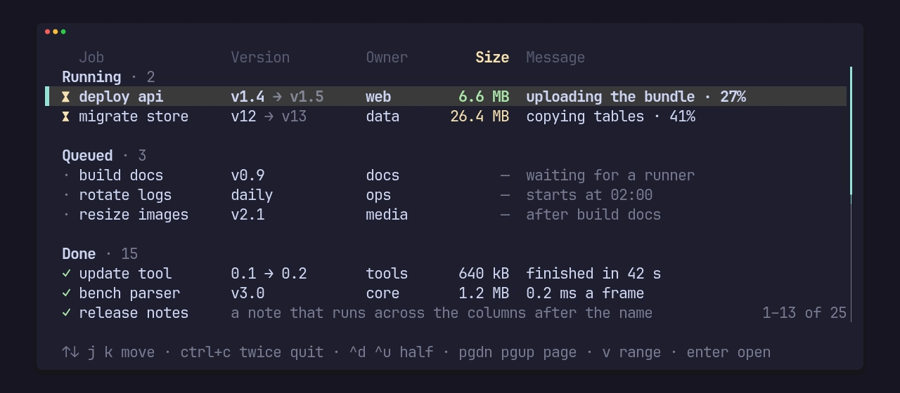</p>

Rows can be grouped under headings (`Row::heading`) with blank lines between
them; the cursor, paging and clicks skip both. `select_range` draws every row
between two ends in the selected style for a Visual mode, with the marker on
the cursor row alone. Cells keep their own colours under the selection when
you ask (`Styles::keep_colours(true)`), and a cell can be several styled parts
(`Cell::parts`), like "v1.4" followed by a faint "→ v1.5".

### Columns that make room

<p align="center">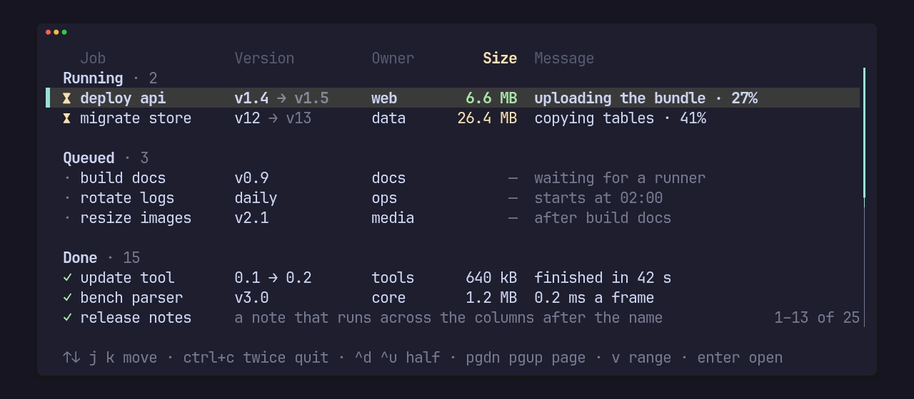</p>

The terminal narrows from 96 to 38 columns and widens back. Each column has a
minimum, a preferred width and a drop priority: when the width runs out the
highest priority drops first (Size, then Version here), a `pinned()` column
never drops, and the flexible column (the message) takes what's left and cuts
after a whole word with "…" (`pito_tui::list::cut` gives apps the same cut).
`fit(max)` sizes a column to its widest cell on screen, `right()` aligns
numbers, and `rest()` lets one cell run across the columns after it. Widths
are Unicode-aware, so diacritics, wide glyphs and "…" measure and clip
cleanly.

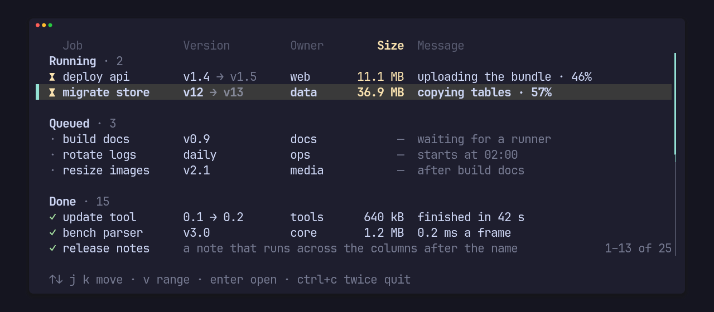

The same list at 46 and 38 columns: first Size drops, then Version, while Job
and Owner stay and the message clips with "…".

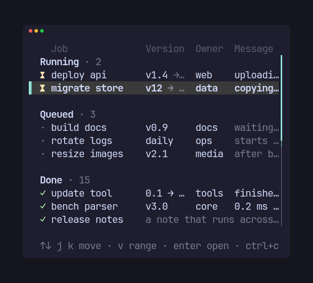
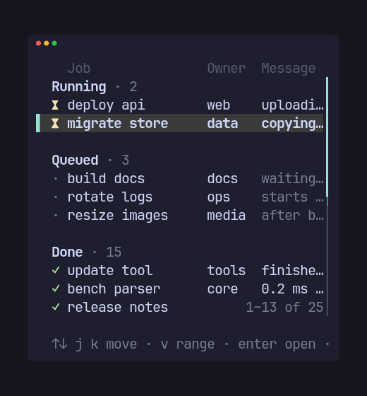

### Scrolling, paging, a scrollbar and a count

<p align="center">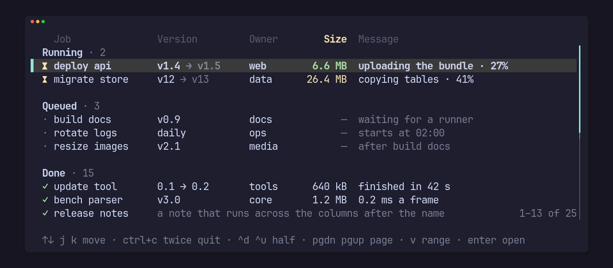</p>

The view keeps the selection in view, paging moves by the rows on screen
(`Paging::View` keeps the cursor on its screen line instead), and an end line
scrolls in after the last row. `ListView::scrollbar(Some(Bar::LINE))` draws a
slim bar with half-cell steps, and `ListView::count(..)` writes "1–13 of 25" in
your words and number format, both only when the list overflows. Keys come in
as the list's own `Key` (arrows, ctrl+d and ctrl+u for half a page, Page Down
and Page Up for a whole one, home, end and enter, or `Keys::VIM` for j/k and
g/G) and go out as a `Step`; `hit`
names the row under a mouse click.

### Rows rewritten in place

<p align="center"></p>

`row_mut`, `Cell::set_text`, `Cell::set_style` and `Mark::set_text` rewrite a
row's texts and colours in the strings already there, so a frame that updates
counters every 120 ms and draws allocates nothing once the strings have grown
to their texts.

### Big lists, built on demand

<p align="center">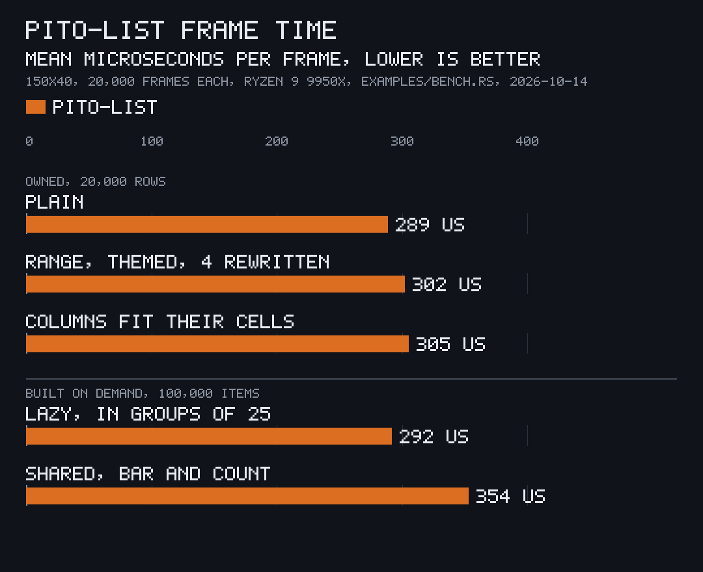</p>

A list can own its rows, or read them from a `Source`: `Shared::new(items,
builder)` wraps your `Arc<Vec<T>>` and builds a row only when a draw asks for
it, so 100,000 jobs, pings or log lines cost what the 40 rows on screen cost.
Hand it a new vector every frame for the price of an `Arc` clone.

### Speed against ratatui's Table

<p align="center">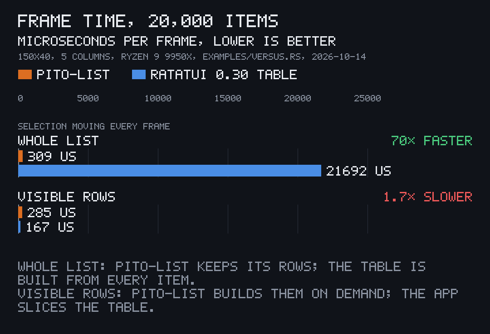</p>

[`examples/list_versus.rs`](examples/list_versus.rs) draws the same 20,000
items (five columns, a header, the selection moving every frame) at 150×40,
with ratatui 0.30's own layout cache on:

| | Mean frame | Allocations a frame | Bytes a frame |
|---|---:|---:|---:|
| The list, owned rows | 309 µs | 0 | 0 |
| The list, shared vector built on demand | 285 µs | 292 | 19,663 |
| ratatui `Table`, every row built each frame | 21,692 µs | 260,062 | 51,844,944 |
| ratatui `Table`, the app slices the visible rows | 167 µs | 569 | 106,032 |

A `Table` handed every row, the way ratatui's own examples build one, is 70×
slower and allocates 52 MB a frame. A `Table` handed only the rows on screen is
1.7× faster than the list, but then the app does the scrolling itself, and it
still allocates where the list's owned rows don't; the list also does the
column dropping, sections, ranges, the end line, the scrollbar and the count
in that time.

### Install

The list comes with pito-tui's one line
([Install and first use](#install-and-first-use)).

`Key::from(crossterm::event::KeyEvent)` (crossterm 0.29, as
`pito_tui::crossterm`) turns a key event into the list's `Key`; drawing needs
no backend, and an app on another backend builds the `Key` values itself. The
conversion turns Alt, Super, Meta or Hyper on a non-character key into
`Key::Other`, keeps Alt apart on a character (`Key::Alt('y')`), and passes
Ctrl+Alt plus a character on as that character, which is how AltGr arrives on
some platforms, so diacritics can still be typed. Ctrl and Shift on a named
key (Tab, Enter, Esc, Backspace, the arrows, Home, End, Page Up, Page Down,
Delete) arrive as `Key::Mod(mods, named)`, such as
`Key::Mod(Mods::CTRL, Named::PageDown)`, so an app can bind them; the plain
key stays `Key::PageDown`. Shift+Tab is `Key::BackTab`. The built-in key maps
hold only plain keys, so a modified key moves nothing in the list and passes to
your app unless you map it.

### A first list

Three rows, three columns, the cursor moved down once:

```rust
use pito_tui::list::{Cell, Column, Key, List, ListView, Row, Styles};
use pito_tui::ratatui::{
    buffer::Buffer,
    layout::Rect,
    style::{Color, Modifier, Style},
    widgets::Widget,
};

let columns = [
    Column::new("Job", 8, 14).pinned(),
    Column::new("Owner", 5, 7).priority(1),
    Column::new("Message", 8, 0),
];
let mut list = List::new().with_rows([
    Row::new(["deploy api", "web", "uploading the bundle"]),
    Row::new([
        Cell::new("build docs"),
        Cell::new("docs"),
        Cell::new("waiting for a runner").faint(),
    ]),
    Row::new(["rotate logs", "ops", "starts at 02:00"]),
]);
list.key(Key::Down);

let styles = Styles::new().selected(Style::new().fg(Color::Yellow).add_modifier(Modifier::BOLD));
for width in [44, 24] {
    let area = Rect::new(0, 0, width, 4);
    let mut buffer = Buffer::empty(area);
    ListView::new(&mut list, &columns)
        .styles(styles)
        .header(true)
        .render(area, &mut buffer);
#   let lines: Vec<String> = (0..area.height)
#       .map(|y| {
#           let line: String = (0..area.width).map(|x| buffer[(x, y)].symbol()).collect();
#           line.trim_end().to_owned()
#       })
#       .collect();
#   let expected: &[&str] = if width == 44 {
#       &[
#           "  Job             Owner    Message",
#           "  deploy api      web      uploading the…",
#           "▌ build docs      docs     waiting for a…",
#           "  rotate logs     ops      starts at 02:00",
#       ]
#   } else {
#       &[
#           "  Job           Message",
#           "  deploy api    …",
#           "▌ build docs    waiting…",
#           "  rotate logs   starts…",
#       ]
#   };
#   assert_eq!(lines, expected);
}
```

draws, at 44 and then 24 cells wide (the Owner column drops when it doesn't
fit):

```text
  Job             Owner    Message
  deploy api      web      uploading the…
▌ build docs      docs     waiting for a…
  rotate logs     ops      starts at 02:00

  Job           Message
  deploy api    …
▌ build docs    waiting…
  rotate logs   starts…
```

In an app, keep the `List` in your state, draw it with
`frame.render_widget(ListView::new(&mut list, &columns), area)`, and pass it
your key events with `list.key(Key::from(event))`: it answers
`Step::Open(index)` for enter.

### Try the list's demo

```sh
cargo run --example list_demo
```

The demo is the clip at the top of this part: sample jobs in three sections
under a styled header, sizes that grow and warm in place, the view following
the selection with a scrollbar and the rows on screen counted at its foot,
`v` for a range, ctrl+d and ctrl+u for half a page, Page Down and Page Up for
a whole one, `g` and `G` for the ends, enter to open and ctrl+c twice to quit,
as in every PITO MD terminal app (the quit guard comes from
[the footer](#a-confirm-and-a-quit-guard)). Every clip and still in this part
is recorded from it with [prec](https://github.com/gmrdad82/prec), the tapes
kept in `render/list/`.

### Everything else about the list

[docs/pages/list/reference/api.md](docs/pages/list/reference/api.md) has
every feature in detail, the whole API and a full example with lazy and
shared sources, sections, a scrollbar and a count. The guides in
[docs/pages/list/guides/](docs/pages/list/guides/) take one task a page, from
a first list in an app to 100,000 items built on demand.

## Keys

`pito_tui::keys` is one keymap per app. The app declares its keys once, in
groups, with the modes and contexts each answers in; from that one
declaration come the action a key does, the footer's hints for wherever the
app is, and the `?` help sheet with every key, so the sheet, the hints and
what a key really does never disagree. The keymap has no words of the
shell's: every key and phrase is the app's, and the sheet's own few words
(its title, "Elsewhere", "nothing matches" and its Help group) are defaults
the app replaces through `keys::Words`.

- **One declaration** for the action, the footer hints and the `?` sheet.
- **Zero allocations** on a steady frame with the sheet open, searched or
  shut, held by a counting-allocator test.

### A first keymap in the shell

Two modes, a list and an editor: the footer shows `down / j next`,
`? help` and `e edits` while listing and `enter saves` while editing, and
`?` opens the sheet with every key.

```rust,no_run
use std::sync::LazyLock;

use pito_tui::crossterm::event::KeyEvent;
use pito_tui::keys::{Chord, Keymap, Mode, Now, bind};
use pito_tui::ratatui::{Frame, layout::Rect, style::Color};
use pito_tui::{Cx, Palette, Screen, Tui};

#[derive(Debug, Clone, Copy, PartialEq, Eq)]
enum Act {
    Next,
    Edit,
    Save,
}

const LIST: Mode = Mode("list");
const EDIT: Mode = Mode("edit");

static KEYS: LazyLock<Keymap<Act>> = LazyLock::new(|| {
    Keymap::new()
        .modes(&[LIST, EDIT])
        .group(
            "List",
            [
                bind("down j", "next", Act::Next).on(LIST),
                bind("e", "edits", Act::Edit).on(LIST).rank(1),
            ],
        )
        .group("Editor", [bind("enter", "saves", Act::Save).on(EDIT)])
});

#[derive(Default)]
struct Home {
    editing: bool,
    row: usize,
}

impl Home {
    fn now(&self) -> Now<'static> {
        Now::new(if self.editing { EDIT } else { LIST })
    }
}

impl Screen<()> for Home {
    fn draw(&mut self, frame: &mut Frame, area: Rect, palette: &Palette) {
        let text = if self.editing { "editing" } else { "listing" };
        frame.buffer_mut().set_string(area.x, area.y, text, palette.ink);
    }

    fn key(&mut self, key: KeyEvent, cx: &mut Cx<'_, ()>) {
        let Some(chord) = Chord::from_crossterm(&key) else {
            return;
        };
        match KEYS.action(self.now(), chord) {
            Some(Act::Next) => self.row += 1,
            Some(Act::Edit) => self.editing = true,
            Some(Act::Save) => self.editing = false,
            None => return,
        }
        cx.keys_now(self.now());
    }
}

fn main() -> std::io::Result<()> {
    Tui::new("hello", "0.1.0", Color::Cyan)
        .screen("Home", Home::default())
        .keymap(&KEYS)
        .keys_now(Now::new(LIST))
        .run()
}
```

`Tui::keymap` takes a `&'static` keymap, which a `LazyLock` gives; every hint
then borrows its words from it. `Tui::keys_now` sets where the app starts,
and a screen calls `cx.keys_now(now)` whenever its mode or a context changes;
the next frame's hints and the open sheet follow. Hints the app passes to
`Tui::hints` still show, after the keymap's.

### The model

- **Group**: a section of the sheet (List, Editor, Player, Export…), in the
  order declared. `Keymap::modes(&[..])` orders the modes; a mode a bind
  names joins the order on its own.
- **bind(keys, does, action)**: `keys` is one or more chords, space-separated
  (`"ctrl+z"`, `"up down"`, `"shift+space"`, `"f2"`, `"?"`). A misspelled key
  panics at declaration with `pito-tui: 'ctlr+z' is not a key`, so any test
  that builds the keymap catches it. `does` is the one phrase both the sheet
  and the footer show.
- **.on(mode) / .modes(&[..])**: the modes or screens it answers in; none
  means everywhere. **.when(context)**: only while that context holds, such
  as `When("while the cut plays")`; a contextual bind declared before a
  general one on the same key overrides it while the context holds.
- **.shown(text)** writes the keys differently (`"up and down"`); otherwise
  the chords are written `ctrl+z`, `shift+a`, `space`, `pgdn`, `f2`,
  `cmd+…` on macOS and `super+…` elsewhere, joined by `" / "` (`.joiner(..)`).
- **.note(text)**: longer words shown only on the sheet. **.rank(n)**: the
  footer's priority, 0 first, as `footer::Hint::rank`; the footer drops the
  highest ranks first when the width runs out. **.quiet()**: on the sheet
  only, never in the footer.
- **Now { mode, when }**: where the app is: `Now::new(CUT).when(&[PLAYING])`.

### What it answers

| call | gives |
| --- | --- |
| `keys.action(now, chord)` | the action that key does here, the first live bind in declared order |
| `keys.hints(now)` | the live hints for a footer, by rank: `Hint { keys, does, rank }`, `"? help"` among them; `footer::Hint::from(hint)` makes the footer's |
| `keys.ticker(now)` | a `Line` per mode, the current one first (all its live hints), then the others' plain hints; `line.to_string()` is `"right keeps · left drops"` |
| `sheet.view(&keys, now)` | the sheet: `here` (the current mode's binds, grouped, `live` false for a context that doesn't hold) then `elsewhere` (the rest, grouped, with their modes), filtered by the search |
| `keys.clashes()` | binds that answer the same chord in the same place, where the first silently wins; assert it empty in the app's tests |
| `keys.button()` | the help button's words, `"? Help"` |

The keymap does its work once, when it is declared: each bind's written keys
and search text, and each mode's hints in rank order. So `action` is one pass
with no allocation, the footer's hints are copied from a ready list, and the
sheet's search tests each bind's text without lowercasing it again. The
search keeps its first 64 characters and its first 8 words, so a pasted page
can't stall the frame.

### The conventions

`keys::Sheet` holds them, so every app behaves the same:

- `?` opens and closes the sheet; esc closes it (first clearing a search);
  `/` searches it (typing goes to the search, enter keeps it, esc drops it);
  pgdn and pgup scroll it a page at a time.
- It never steals focus: `sheet.key(chord)` returns `Outcome::Took` only for
  those keys and `Outcome::Pass` for every other, which reaches the screen as
  if the sheet were closed. Opening it changes no selection, mode or
  playback, and the sheet shows the mode the user is in.
- The sheet lists its own keys in a last group, `Help`; `keys::Words`
  changes the wording to the app's voice.
- A screen typing into its own input gets `?` as text: the shell asks the
  sheet only when no screen is typing.
- Keys follow what is shown: when a key the sheet passed on opens a modal, a
  pick, a confirm, a takeover or a typing input, or shuts the gate, the sheet
  closes, so nothing acts hidden under it. While it searches a paste goes to
  its query; while it is open otherwise a paste goes nowhere.
- A visible Help or `?` button calls `cx.toggle_sheet()`.
- `ctrl+c` quits from anywhere, the open sheet and its search included.

### The `?` sheet

The shell draws the sheet as a centred overlay over the screen, in the
palette's rule, accent and ink: the current mode's name, then each group of
the keys that answer here, each row its keys then what they do, its note,
and its context in parentheses, muted while the context doesn't hold; then,
under the keymap's "Elsewhere", the keys of the other modes with the modes
they answer in. While a search is typed its query shows on the first row.
When the keys outgrow the area the sheet keeps its height and scrolls a page
at a time, with an arrow on its border for each way there is more. It fits
80x24 to 200x60, eases open and closed over 180 ms (`Tui::still(true)` shows
and hides it at once), and draws from the loop's moment, so a headless run
gives the same frames. An app with its own loop draws the same sheet with
`keys::Panel`: `panel.key(chord, now)` before its own keys,
`panel.draw(buf, area, &palette, &KEYS, now, moment)` after its screen, and
another frame while `panel.animating(moment)`.

### Input

`keys::Chord { key, mods }` is the keymap's own. A `Char` carries shift in
its case (`shift+a` is `Char('A')`), so `?` is `?` however the platform
reports it, and `Char(' ')` is `Space`. `Chord::from_crossterm(&KeyEvent)`
converts crossterm's events (a release gives `None`, shift+tab is
`shift+tab`); a desk's own key type or winit maps in a few lines with
`Chord::new(Key::…, Mods::…)`.

### Try the keys demo

```sh
cargo run --example keys_demo
cargo run --example keys_demo -- --dump 90x24 right '?'
```

A rail of clips and a cut in two modes, a player with a context, a note, a
quiet bind and the `?` sheet with search; `--dump WxH keys…` prints one
frame as text after those keys. Its tape for prec is kept in
`render/keys/`.

## Adopting pito-tui

This section is for an app that already draws the header, footer, hourglass
and list itself, and keeps its own loop. Moving to the
shell deletes that glue; the app's screens and data stay as they are.

### What the app keeps

- Its screens' content: what each one draws, its data, its rows and
  columns, its detail views. The list and the footer's `Input` stay the
  app's to use inside a screen, through `pito_tui::list` and
  `pito_tui::footer`.
- Its words, every one, in any language: `Words` for the shell's few
  places (the help word, the quit notice and question and its hint line,
  Yes and No, the confirm's hint line, the too-small message, the hint
  under the hourglass), `Activities` for the activity band and screen, the
  global hints, and each screen's hints, facts, notices, labels and
  messages. An empty word is simply not drawn.
- Its keys beyond the shell's: anything a screen's `key` takes, and
  app-wide actions through `on_key`. The shell's own keys are the app's to
  change too: `nav_keys` (the header's `NavKeys`, `NavKeys::NONE`
  included), `quit_keys`, `stop_keys`, `help(None)`, and the filter's
  `start_keys` and `clear_keys`. Mouse capture stays off unless the app
  turns it on with `Modes`.
- Its workers and their messages: the app's own enum is the `E` in
  `Tui<E>`, and its threads post through a `Waker<E>`.
- Its command line: the app parses its own flags and calls the shell's
  headless helpers.
- Its crash reporting: a panic hook the app installs before `run` still
  runs, after the shell has given the terminal back on a UI-thread panic. A
  hook that ends the process calls `pito_tui::restore()` before it exits,
  so a panic on a worker thread gives the terminal back too:

  ```rust,no_run
  std::panic::set_hook(Box::new(|info| {
      pito_tui::restore();
      eprintln!("{info}");
      std::process::exit(101);
  }));
  ```

### What the shell takes over

| The app's own code today | With pito-tui |
|---|---|
| `ratatui::init` and `ratatui::restore`, bracketed-paste and mouse toggles, panic hooks that restore the terminal | `Tui::run` (or `Term::enter` for a loop of its own) |
| An input thread feeding a channel, an enum with an input arm, `recv_timeout` | `listen` and `Wake<E>`, inside `run` |
| A frame pacer, a dirty flag, deadlines, draining a batch of wakes | `run`: `Pace` at 120 fps, synchronized updates, `deadline` and `animating` per screen |
| Polls on a timer, slow reads timed out, a clock threaded into drawing | `Screen::deadline` and `tick`, `Screen::moment`, `Tui::advance` headless |
| Code that hands the app's asks to threads and routes their answers back | `Screen::load` (tracked by generation) and `Cx::detach` (one-off work) |
| Key routing: release, quit guard, confirm, input, help, nav | `Tui::key`, in that order |
| Quit guard wiring: busy count, wording, tick, deadline, notice, bar | `Screen::busy`, `Words::again` and `Words::busy`, `quit`, `quit_window` |
| A confirm gathered from several places | `Cx::confirm` and `Screen::answer` |
| Header assembly: title, help word, a lead beside it, a status fitted to the room, facts, a breadcrumb kept in step | `Screen::lead`, `status_parts`, `badge`, `facts`, `crumb`, `selected` and `back`, `keep_facts` |
| Footer assembly: hints, notice, legend, confirm, input, version, height | `Screen::hints`, `input`, `notice`, `legend`, `Cx::say`, `Words::leave`; the version slot is wired |
| A panel of running work above the footer and a screen listing it, with a detail view | `Activities`, fed by `Cx::activity`, `activities` and `forget`; or the app's own `Band` and `Tui::overlay` screen |
| A screen of its own opened over any other by a key, with unlit tabs and its own breadcrumb | `Tui::overlay(section, keys, screen)` |
| Code that runs the app's own CLI, parses its `--progress json` lines and stops it | `Cx::run(id, label, Command)` (`Cx::run_from` when the lines come on stderr), `Cx::stop(id)`, `Screen::heard` for each line and the exit, and `command::read` for a single line |
| A picker drawn over a screen, its keys and its answer | `Cx::pick(Pick)` and `Screen::picked` |
| A long-log or trace pane: scroll, page, ends, find, copy, a cache of built rows | `Log`; a long list takes the list's `Shared` |
| Age and duration text, Braille bars, percent, spinners, label redraw timing | `clock`, `progress`, `Activity::estimate` |
| Frames compared cell by cell before and after a change, by hand | `capture::capture` and `capture::compare` behind `--capture` and `--compare`, `capture::Recorder` for the frames from before the move or from an app that keeps its own loop, and `capture::compare_dirs` for two captures |
| A tone module mapped to the header's, footer's, list's and hourglass's `Styles` | `Palette`, and `Cx::palette` at runtime |
| A loading wrapper around the hourglass | `Phase::Loading(label)` |
| The too-small guard, a centred message, OSC 52, text helpers | `min_size` and `Words::too_small`, `message`, `Cx::copy`, `text` |
| Dump size and key parsing, text and ANSI output, a bench loop | `dump::*`, `Tui::shot`, `Tui::bench` |

### Moving over, step by step

1. **One pin.** Put the pito-tui line above in `Cargo.toml`, and import the
   widgets through `pito_tui::header`,
   `pito_tui::footer`, `pito_tui::hourglass` and `pito_tui::list`. Keep
   ratatui and crossterm through `pito_tui::ratatui` and
   `pito_tui::crossterm`, or pin the same versions (0.30 and 0.29).
2. **The palette.** Build `Palette::new(accent)`, then set the tokens the
   app's tone module had (`good`, `bad`, `muted`, `base` for a painted
   background). Hand it to `Tui::palette`.
3. **The words.** Move every shell-facing string into one `Words` and the
   app-wide hints (`? help`, `ctrl+c twice quit`) into `Tui::hints`.
4. **One screen at a time.** Make each section or page a type that
   implements `Screen<E>`: its draw function becomes `draw`, its hints and
   facts become `hints` and `facts`, its loader becomes `load` (return the
   work as a closure) and `loaded` (take the answer from the app's enum, no
   downcast), its "stop waiting" becomes `cancel`, its detail view becomes
   `crumb` plus `back`, and its search box becomes a `Filter` or its own
   `Input` returned from `input` while `typing` is true. A password field is
   an `Input::new().masked(true)`; a bracketed paste arrives in `paste`.
5. **Groups.** `Tui::group(Group::new("Work"))` before the screens that
   belong to it; screens before any group join one unnamed group, and a
   single group draws no groups row.
6. **Workers.** One-off work goes through `Cx::detach(move || E::Done(..))`
   and comes back to the same screen's `event`. A long-lived watcher takes
   `cx.waker()` (or `tui.waker(index)` before `run`) and posts with
   `send`. A watcher that sees a source change sends an event whose screen
   calls `cx.changed("source")`. A poll on a timer is a screen's `deadline`
   with the poll in its `tick`, which gives the next deadline.
7. **Activities.** If the app shows what it has running (operations,
   exports, simulations), give `Tui::activities` an `Activities` with the
   screen's name (`Section::new("Operations")`), the key that opens it, its
   hints and its words (the empty message, the overflow line, the elapsed
   time, the facts). Whichever screen hears about the work calls
   `cx.activity(Activity::new(id, label, started)...)` each time it changes,
   with the same `id`; `cx.activities(..)` replaces the whole list, which
   suits an app that reads its work as a list, and `cx.forget(id)` drops
   one. The app's own panel and its screen go; their data stays where it
   was. The activity screen always comes after the app's screens, wherever
   `Tui::activities` sits in the builder chain, so the screens keep the
   indices `go`, `waker` and `event` use. The demo's fake jobs (`Home` in
   `examples/demo.rs`) are the pattern.
8. **The loop goes.** Replace the app's `run` with `Tui::run()`; delete
   the pacer, the terminal setup and restore, the restoring panic hooks,
   the input thread and the key routing. The app's crash hook stays where
   it is, installed before `run`; if it ends the process, it calls
   `pito_tui::restore()` before it exits.
9. **Headless flags.** Wire `--dump WxH` to `dump::size` and `Tui::shot`,
   `--keys` to `dump::keys`, `--ansi` to `dump::ansi`, `--loading` to
   `shot(.., settle: false)`, `--at MS` to `Tui::advance` and a second
   `frame`, `--bench N` to `Tui::bench`, and `--capture DIR` and
   `--compare DIR` to `capture::capture` and `capture::compare` with a
   `capture::Walk` of the app's deeper states (exit 1 when a frame
   differs); `main` and `walk` in `examples/demo.rs` do exactly this. A dump
   or a walk with fixtures builds the screens from fixture data, so the
   same build gives the same frames. A game that keeps its dev tools out of
   the shipped build puts these behind its own feature.
10. **Check.** Before the move, record every screen and deeper state at
    the sizes the app cares about with the old build, through
    `capture::Recorder` ([Proving the switch](#proving-the-switch)); after
    it, compare. The header, footer and spacing should match, since the shell
    draws them with the same widgets and the same layout (a one-cell side
    margin for the header and footer, two cells for the content, one row
    above the footer). Then delete the captures: they are a safety net for
    the move, not a test to keep.
11. **What the app had built in.** Its own pickers become `Cx::pick`, its
    log and trace panes a `Log` (a long list a `list::Shared`), its
    age and duration text `clock`, its bars and spinners `progress`, and the
    code that ran its own CLI and read the progress lines `Cx::run` (or
    `Cx::run_from` for lines on stderr), with `Cx::stop` for its stop and
    `Screen::heard` for what it read from the lines and the exit; the app
    keeps its own words on the band by posting its activity for that id.

### Proving the switch

`capture::capture` walks an app that already runs on `Tui`, so it can't
record the old build. `capture::Recorder` writes the same frames from the
buffers the app's own headless dump draws: record them with the old build,
switch to `Tui::run`, and `capture::compare` walks the new build against
them, scenario names and sizes matched.

- `Recorder::new(dir)` wants a directory that is absent or empty, as
  `capture` does.
- `screen(index, name, &buffer)` saves a screen the way a walk names it:
  `index` is its place among the new build's screens, in the order the app
  adds them with `Tui::screen` (the activity screen comes after all of
  them), and `name` its section's name.
- `record(name, &buffer)` saves a deeper state under the name the new
  build's `capture::Script` carries, so `record("Next drilled in", ..)`
  meets `Script::new("Next drilled in", keys)`.
- A frame is the whole terminal at one size, as a `TestBackend` holds it
  after a draw; its size is the buffer's own. Record each state at every
  size the walk lists. The same state at the same size twice is an error,
  so two states never share a name by accident.
- Both builds draw from the same fixture data at the same moment, as any
  capture does.
- `Recorder::against(dir)` takes the same calls but compares each frame
  with the one of the same name in `dir`, an existing capture, instead of
  writing it; `finish()` then lists the differences, as `compare` does. So
  one function that draws every state into a `&mut Recorder` gives an app
  both `--capture DIR` (`Recorder::new`) and `--compare DIR`
  (`Recorder::against`), as below.
- `capture::compare_dirs(before, after)` compares two captures already on
  disk, frame by frame and cell by cell: each frame in both, each one only
  `after` holds (`Added`) and each one only `before` holds (`Removed`).
  Either may come from `capture::capture` or from a `Recorder`.

```rust,no_run
use std::path::Path;

use pito_tui::capture::Recorder;
use pito_tui::ratatui::{Frame, Terminal, backend::TestBackend, buffer::Buffer};

struct OldApp;

impl OldApp {
    fn open(_state: &str) -> Self {
        OldApp
    }

    fn draw(&self, _frame: &mut Frame) {}
}

fn shot(state: &str, (width, height): (u16, u16)) -> Buffer {
    let app = OldApp::open(state);
    let Ok(mut terminal) = Terminal::new(TestBackend::new(width, height));
    let Ok(_) = terminal.draw(|frame| app.draw(frame));
    terminal.backend().buffer().clone()
}

fn states(recorder: &mut Recorder) -> std::io::Result<()> {
    for size in [(80, 24), (120, 34)] {
        recorder.screen(0, "Home", &shot("home", size))?;
        recorder.screen(1, "Next", &shot("next", size))?;
        recorder.record("Next drilled in", &shot("next/detail", size))?;
    }
    Ok(())
}

fn main() -> std::io::Result<()> {
    let args: Vec<String> = std::env::args().collect();
    match args.get(1..3) {
        Some([flag, dir]) if flag == "--capture" => {
            let mut recorder = Recorder::new(Path::new(dir))?;
            states(&mut recorder)?;
            println!("{} frames", recorder.frames());
        }
        Some([flag, dir]) if flag == "--compare" => {
            let mut recorder = Recorder::against(Path::new(dir))?;
            states(&mut recorder)?;
            let differences = recorder.finish()?;
            for difference in &differences {
                println!("{difference}");
            }
            if !differences.is_empty() {
                std::process::exit(1);
            }
        }
        _ => {}
    }
    Ok(())
}
```

After the switch, `capture::compare` with
`Walk::new().sizes([(80, 24), (120, 34)]).script(Script::new("Next drilled
in", keys))` and the new build's `Fn() -> Tui<E>` lists each cell that
differs, each frame only the new build draws (`Added`) and each one it no
longer reaches (`Removed`). An empty list proves the switch; then delete the
directory.

An app that keeps its own loop (its own `Term`, `listen`, `Waker`, `Pace`
and `wait_until`) proves a change the same way without moving: `--capture
tmp/before` with the old build, then `--compare tmp/before` with the new
one, or `--capture tmp/after` with the new one and
`capture::compare_dirs(Path::new("tmp/before"), Path::new("tmp/after"))`.

### An app that already has a section trait

Most of it maps one to one: a section's name becomes the `header::Section`
passed to `Tui::screen`; its data sources, phase, cancel and retry become
`sources`, `phase`, `cancel` and `Cx::reload`; a loader that returns a job
and a delivery to downcast becomes `load` returning a closure and `loaded`
taking the app's own enum, with the generation kept by the shell; its notice
becomes `Cx::say`; its pending confirm becomes `Cx::confirm` with `answer`;
its asks become `Cx::detach`. A job that needs a connection or a client opens
or clones its own inside the closure, since it runs on a worker.

An overlay that lists the app's running work becomes `Activities`. Any other
overlay that sits over every section becomes a screen of its own (in its own
group if it should read as one), or stays the app's drawing inside a screen
with `crumb` naming where the user is.

## Development

`bin/gate` runs `cargo fmt --check`, `cargo clippy --all-targets
--all-features -- -D warnings`, the tests (`cargo nextest run`, then this
README's examples, each widget's module page and the list's docs pages as
doctests) and the release build of the demo.
`bin/gate --fast` leaves the release build out. The tests are a safety net for what would hurt if it
broke: the frame pacing, the terminal restore, the key order, the load
generations and the dump formats. The header, footer, hourglass, list and
keys keep their own tests in `tests/<module>/`, drawing through ratatui's
`TestBackend`, and `tests/<module>_allocation.rs` holds with a counting
allocator that drawing them (and hit-testing the header, a warm frame of the
list, and a steady frame with the `?` sheet open) allocates nothing. Each release is listed in
[CHANGELOG.md](CHANGELOG.md). The clips are the demo recorded in a pseudo-terminal by prec from
[render/terminal.toml](render/terminal.toml) and its tapes, made into GIFs by
pcod (pito-codecs), and the chart is drawn by pcmp from
[docs/images/frames.toml](docs/images/frames.toml). Each widget's clips and
stills are its own examples recorded by prec from
`render/<module>/render/terminal.toml` and its tapes, and its charts are drawn
by pcmp from the data beside them in `docs/images/<module>/`;
`bin/header-shots` makes the header's images again.

`bin/docs-bundle` builds this crate's section of the PITO MD docs site: the
guides and reference pages in [docs/pages](docs/pages), the changelog, the
images and the `cargo doc` API, checked for broken links and packed into
`tmp/docs-vX.Y.Z.tar.gz`, which each tag's GitHub Release carries.

## Contributing

Issues and pull requests are welcome. Please read the
[code of conduct](CODE_OF_CONDUCT.md) first. A change keeps `bin/gate` green
with no warnings, draws the header, footer, hourglass and list without
allocating, keeps the hourglass a function of the elapsed time alone, and
leaves every word, style and key to the app. Report a
security issue privately, as [SECURITY.md](SECURITY.md) says, not in a public
issue.

## Licence


The code is MIT licensed: see [LICENSE](LICENSE), by Catalin Ilinca. The PITO MD
name and its logos, and the names and logos of every PITO MD app and game, are ©
Catalin Ilinca, all rights reserved, and are not covered by the MIT licence;
see [TRADEMARKS.md](TRADEMARKS.md). The GIFs, stills and charts in
`docs/images/` are captures and measurements of the demo and of the widgets'
own examples, under the MIT licence like the code
([docs/images/NOTICE](docs/images/NOTICE); [NOTICE.md](NOTICE.md) names the
source of each). The look of the header, footer, list and hourglass is in the
style of HEY's terminal UI, and the hourglass's frames and their timing come
from [basecamp/hey-cli](https://github.com/basecamp/hey-cli) under its MIT
licence; see [NOTICE.md](NOTICE.md).
